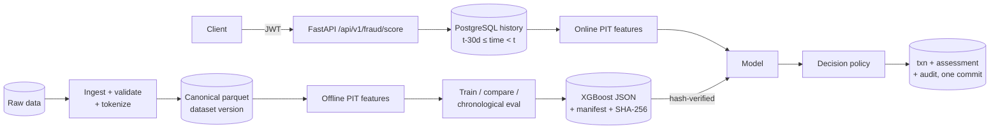

# Real-Time Fraud Detection & Risk Intelligence Platform

A fraud-risk scoring platform built phase by phase: a reproducible ML pipeline with leakage checks,
plus a low-latency scoring API that uses the same point-in-time feature definitions online as in
training. Decisions are **sandboxed**: nothing here connects to real money movement.

> **Status: Phase 1 vertical slice.** The working path is: ingest → validate → features → train and
> evaluate → versioned artifact → authenticated real-time scoring → policy decision → audited
> persistence. The dashboard, streaming layer, rules engine, case management and MLOps monitoring
> are designed but **not built yet**; see [Roadmap](#roadmap). Nothing below describes them as
> working.

## The problem

Card fraud is rare (here 0.5% of transactions), bursty (a compromised card is used many times in a
short window) and asymmetric in cost (missed fraud vs. analyst review vs. customer friction). A
useful system has to rank risk well at a fixed review capacity, make that ranking available within
milliseconds of a transaction, and keep a model's *estimate* separate from the *action* taken on it.

## Fraud domains

The framework is domain-adapter based (`ml/fraud_ml/domains/`). Only **card payments** is
implemented, trained and evaluated. Account takeover, insurance claims, e-commerce refund abuse and
transfers each need their own data, features and separately validated models. Nothing here
assumes a card model transfers to them.

## Architecture



Details: [architecture overview](docs/architecture/overview.md) (components, inference sequence,
failure modes, streaming design, broker choice, monitoring) ·
[database design](docs/architecture/database-design.md) ·
[dataset selection](docs/data/dataset-selection.md) ·
[model development plan](docs/ml/model-development-plan.md) ·
[model card](docs/ml/model-card-card-fraud-xgb-1.0.0.md) ·
[security](docs/security/security.md)

## Dataset

[Sparkov card transactions](docs/data/dataset-selection.md): 1,852,394 transactions, 999 cards,
2019–2020, 0.52% fraud. It was chosen over ULB, PaySim and IEEE-CIS because it is the only one with
stable entity IDs, real calendar timestamps and a permissive license, which are the
prerequisites for point-in-time behavioral features and replay. **It is synthetic**, and its fraud
is much easier to detect than real fraud. The download is SHA-256 pinned and was verified against
the Kaggle original's published row counts, fraud counts and time ranges.

## Results (synthetic data — read the caveat above)

Chronological split; selection and threshold on validation; the test window (= published
`fraudTest.csv`, 555,719 rows, 0.39% fraud) was scored once at the end.

| Model (validation) | AP | Brier | Recall @ top 0.5% |
|---|---|---|---|
| Prevalence baseline (dummy) | 0.006 | 0.0059 | 0.007 |
| Logistic regression | 0.399 | 0.0360 | 0.411 |
| Random forest | 0.947 | 0.0024 | 0.801 |
| **XGBoost (selected)** | **0.978** | **0.0006** | 0.838 |
| XGBoost + class weighting | 0.978 | 0.0017 | 0.835 |

**Held-out test, selected model:** AP **0.955** (95% customer-cluster bootstrap CI 0.946–0.963),
precision 0.876 and recall 0.904 at the validation-chosen threshold, FPR 0.049%, ECE 0.00017.
Full tables, segments and calibration are in the [model card](docs/ml/model-card-card-fraud-xgb-1.0.0.md).

## Measured latency (not a load test)

20,000 held-out-window events replayed sequentially through the HTTP API by one client
(`scripts/replay_score.py`, report in `ml/reports/replay_20261026T070038Z.json`). Each request
included a PostgreSQL history query, feature computation, inference, policy and a transactional
write.

| | p50 | p95 | p99 |
|---|---|---|---|
| Server processing (validation → decision, excl. commit) | 3.3 ms | 9.9 ms | 11.3 ms |
| Client round trip (incl. commit + HTTP) | 7.6 ms | 15.2 ms | 17.1 ms |

Throughput: 117 req/s, **sequential, single client**, which measures latency rather than capacity.
Environment: Apple M4 Pro (14 cores), 24 GB RAM, macOS 26.6.1, Python 3.12.13, uvicorn with 1
worker, PostgreSQL 17.6 in Docker 29.4.3 on the same host. Concurrent load testing (Locust/k6) is
Phase 9.

The same replay checked **training/serving parity on real data**: for 200 sampled events the
API's stored features matched the offline pipeline to a max relative difference of 1.7e-12, and
scores matched exactly.

## Quick start

Prerequisites: [uv](https://docs.astral.sh/uv/), Docker. Python 3.12 is installed by uv.

```bash
cp .env.example .env            # then replace every change-me with a random secret
make install                    # uv sync
make data                       # download + SHA-256 verify (~500 MB)
make ingest                     # -> ml/data/processed (validated, tokenized, versioned)
make train                      # ~1 min on an M4 Pro -> ml/artifacts/card-fraud-xgb-1.0.0
make promote                    # ml/artifacts/current -> that artifact
make db-up migrate

set -a; source .env; set +a
uv run python -m fraud_api.cli create-org --slug demo --name "Demo Bank (sandbox)"
FRAUD_NEW_USER_PASSWORD='<12+ chars>' uv run python -m fraud_api.cli create-user \
    --org demo --email svc@demo.example.com --role service
uv run python -m fraud_api.cli load-history --org demo \
    --data ml/data/processed/card_transactions.parquet \
    --start 2020-05-22T12:14:00+00:00 --end 2020-06-21T12:14:00+00:00
make api                        # http://127.0.0.1:8000/docs
```

Replay the held-out window through the API (labeled `source=replay`):

```bash
FRAUD_REPLAY_PASSWORD='<password>' uv run python scripts/replay_score.py \
    --email svc@demo.example.com --start 2020-06-21T12:14:00+00:00 --limit 20000 --verify-every 100
```

Docker (API container; migrates on start, runs as non-root, model mounted read-only):

```bash
docker compose --profile api up -d --build
```

## API

OpenAPI UI is at `/docs`. Implemented endpoints:

| Method | Path | Roles |
|---|---|---|
| GET | `/health/live`, `/health/ready` | public |
| POST | `/api/v1/auth/token` | public (credentials) |
| POST | `/api/v1/fraud/score` | service, admin |
| GET | `/api/v1/fraud/predictions/{assessment_id}` | admin, analyst, viewer, service |

Request and response below were captured from the Docker container (the customer is brand new, so
it has no history):

```bash
curl -s -X POST http://127.0.0.1:8000/api/v1/fraud/score \
  -H "Authorization: Bearer $TOKEN" -H 'Content-Type: application/json' \
  -d '{"transaction_id":"docker_smoke_1","customer_id":"cus_00000000000000ff","amount":"842.17",
       "currency":"USD","category":"shopping_net","event_time":"2020-12-31T23:00:00Z",
       "source":"simulated"}'
```

```json
{
  "assessment_id": "ef1fe1c8-e577-4ebd-8b90-071f3d0a5421",
  "transaction_id": "docker_smoke_1",
  "status": "scored",
  "risk_score": 0.9999918937683105,
  "risk_level": "critical",
  "decision": "decline",
  "decision_mode": "sandbox",
  "reasons": ["score>=0.9985 (decline_at)"],
  "model_name": "card-fraud-xgb",
  "model_version": "1.0.0",
  "policy_version": "card-policy-2026-10-26.1",
  "source": "simulated",
  "processing_time_ms": 10.45,
  "scored_at": "2026-10-26T07:03:58.383961Z",
  "idempotent_replay": false
}
```

Contract notes: `event_time` must include a timezone; `amount` is a decimal with ≤ 2 places;
`category` must be a known card category; unknown fields (e.g. `cvv`) are rejected. Retrying with
the same `transaction_id` and payload returns the original decision (`idempotent_replay: true`);
reusing it with a different payload returns `409`. If the model is unavailable, the default
`FRAUD_FAILURE_MODE=manual_review` returns `status: degraded`, `risk_score: null`,
`decision: review`. It never returns `allow`.

## Tests

```bash
make lint typecheck             # ruff + mypy --strict
make test                       # needs `make db-up` for integration tests
```

Last local run: **74 passed**: 46 unit tests (feature parity and leakage, ingestion and
tokenization, metrics, policy, artifact integrity, training reproducibility, test-label
independence) and 28 integration tests against PostgreSQL (auth and forged tokens, RBAC,
validation, real-model scoring correctness, idempotency including 8 concurrent duplicates, tenant
isolation, degraded and reject modes, history-limit handling, append-only audit log, DB-level
invariants, race-free model registration). The CI workflow (`.github/workflows/ci.yml`) mirrors
this but **has not run yet**, because the repository has not been pushed.

## Repository structure

```text
apps/api/fraud_api/      FastAPI app: core (config, logging, security, errors), db (models,
                         session), scoring (schemas, policy, service), api (deps, routes), cli
apps/api/migrations/     Alembic migrations (0001 initial schema + append-only audit trigger)
ml/fraud_ml/             ML library shared by training and serving
  domains/               domain adapters (card_payments)
  data/                  raw/canonical schemas, ingestion
  features/              spec + offline (vectorized) + online (per-event) implementations
  training/ evaluation/  candidates, splits, selection, rare-event metrics, bootstrap CIs
  models/                pickle-free artifact save/load with hash verification
ml/configs/              training config, decision policy (bound to a model version)
ml/data/, ml/artifacts/  git-ignored; produced by make data/ingest/train
scripts/                 dataset download (SHA-pinned), API replay/parity harness
tests/unit, tests/integration
infrastructure/docker/   API Dockerfile, Postgres init
docs/                    architecture, data, ml, security
```

The monorepo layout in the brief (`services/`, `packages/contracts`, `apps/web`, `infrastructure/aws`)
will be added when those phases ship. Empty placeholder directories were deliberately not created.

## Security

Implemented controls and the gaps a regulated deployment would still need to close are listed in
[docs/security/security.md](docs/security/security.md). No compliance certification is claimed.

## Known limitations

* Synthetic labels and generator artifacts inflate every metric (the top gain feature is
  `category=grocery_pos`).
* No device, login, decline or authentication data, so those behavioral features don't exist.
* The dataset clock's timezone is unknown; hour features assume UTC.
* Cold-start customers can score very high (see the model card).
* Not deployed anywhere. AWS deployment is designed for Phase 10 and has not been executed.

## Roadmap

| Phase | Scope | Status |
|---|---|---|
| 1 | Architecture, dataset, contracts, vertical slice | **Done** |
| 2 | Data engineering: richer quality reports, Parquet/Postgres ingestion paths | Partly done (ingestion, validation, quality report, versioning) |
| 3 | ML: Optuna with time-series CV, SMOTE/undersampling comparison, SHAP, anomaly baselines, MLflow | Next |
| 4 | Scoring API: batch endpoint, model metadata endpoints | Single-event scoring done |
| 5 | Redis Streams ingestion, workers, DLQ, simulator, SSE | Designed |
| 6 | Rules engine, analytics endpoints | Designed (DDL ready) |
| 7 | Next.js command center | Not started |
| 8 | Case management, label provenance | Designed (DDL ready) |
| 9 | Prometheus/Grafana, drift, promotion gates, load tests | Designed |
| 10 | Rate limiting, TLS, secrets manager, AWS (ECS/RDS/ElastiCache) | Not started |

## License

MIT (code). The dataset is not redistributed; its license and terms are those of its source.
