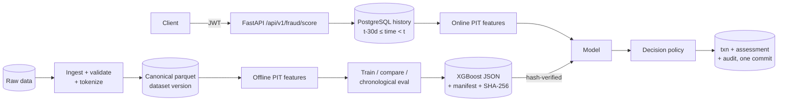

# Real-Time Fraud Detection & Risk Intelligence Platform

A fraud-risk scoring platform built phase by phase: a reproducible ML pipeline with leakage checks,
plus a low-latency scoring API that uses the same point-in-time feature definitions online as in
training. Decisions are **sandboxed**: nothing here connects to real money movement.

> **Status: Phases 1–9 complete.** The working path is: ingest (CSV or Parquet) → quality checks
> → canonical tokenized dataset → idempotent PostgreSQL import → features → chronological CV
> tuning and imbalance comparison → versioned artifact + bound policy → gated promotion →
> authenticated real-time scoring (single, batch, or asynchronously through Redis Streams
> workers) → policy decision → versioned tenant rules (escalate only) → audited persistence →
> tenant-scoped SSE feed and analytics endpoints, with read-only model registry endpoints. Serving still uses
> `card-fraud-xgb@1.0.0`; the Phase 3 candidate `1.1.0` passed every promotion gate but has not
> been promoted.
> The Next.js command center (`apps/web`) shows scored transactions with their decision and rule
> trace, TreeSHAP explanations, windowed analytics, rules and a live feed, all from real API
> responses, plus investigation cases and provenance-tracked fraud labels. Phase 9 adds
> Prometheus metrics (local Prometheus/Grafana), drift and label-matured monitoring runs, fully
> gated and audited promotion/rollback, and concurrent load tests. AWS deployment (Phase 10) is
> **not started**; see [Roadmap](#roadmap).

## The problem

Card fraud is rare (here 0.5% of transactions), bursty (a compromised card is used many times in a
short window) and asymmetric in cost (missed fraud vs. analyst review vs. customer friction). A
useful system has to rank risk well at a fixed review capacity, make that ranking available within
milliseconds of a transaction, and keep a model's *estimate* separate from the *action* taken on it.

## Fraud domains

The framework is domain-adapter based (`ml/fraud_ml/domains/`). Only **card payments** is
implemented, trained and evaluated. Account takeover, insurance claims, e-commerce refund abuse and
transfers each need their own data, features and separately validated models. Nothing here
assumes a card model transfers to them.

## Architecture



Details: [architecture overview](docs/architecture/overview.md) (components, inference sequence,
failure modes, streaming design, broker choice, monitoring) ·
[database design](docs/architecture/database-design.md) ·
[dataset selection](docs/data/dataset-selection.md) ·
[ingestion and import](docs/data/ingestion-and-import.md) ·
[model development plan](docs/ml/model-development-plan.md) ·
[model card 1.0.0](docs/ml/model-card-card-fraud-xgb-1.0.0.md) ·
[Phase 3 experiment](docs/ml/phase3-experiment.md) ·
[model card 1.1.0 (candidate)](docs/ml/model-card-card-fraud-xgb-1.1.0.md) ·
[security](docs/security/security.md) ·
[scoring & model API](docs/api/scoring-api.md) ·
[event streaming](docs/architecture/streaming.md)

## Dataset

[Sparkov card transactions](docs/data/dataset-selection.md): 1,852,394 transactions, 999 cards,
2019–2020, 0.52% fraud. It was chosen over ULB, PaySim and IEEE-CIS because it is the only one with
stable entity IDs, real calendar timestamps and a permissive license, which are the
prerequisites for point-in-time behavioral features and replay. **It is synthetic**, and its fraud
is much easier to detect than real fraud. The download is SHA-256 pinned and was verified against
the Kaggle original's published row counts, fraud counts and time ranges.

## Data pipeline (Phase 2)

`make ingest` validates the raw files (CSV or Parquet; both produce the identical canonical
output), reads only the eight required raw columns, tokenizes card numbers, drops exact duplicates
and rejects conflicting ones, sorts events by `(event_time, event_id)`, and writes a canonical
parquet, a quality report and a manifest. Each quality check is either an **error** (exit 1;
only `data_quality_report.failed.json` is written and existing outputs are untouched) or a
**warning** (recorded; `--fail-on-warning` makes it fatal). Large amounts are reported, never
removed. On the real data every check passed with no warnings.

`make import ORG=demo SOURCE=backfill` (or `fraud_api.cli import-transactions`) loads canonical
parquet into PostgreSQL for one organization. Imports are labeled with their source, idempotent
on retry, reject conflicting duplicate ids, and are all-or-nothing in one transaction. Measured:
1,852,394 rows in 58 s, retry in 40 s with 0 inserted, amounts identical to the cent. Details,
check definitions, report format and failure behaviour are in
[docs/data/ingestion-and-import.md](docs/data/ingestion-and-import.md).

## Results (synthetic data — read the caveat above)

Chronological split; selection and threshold on validation; the test window (= published
`fraudTest.csv`, 555,719 rows, 0.39% fraud) was scored once at the end.

| Model (validation) | AP | Brier | Recall @ top 0.5% |
|---|---|---|---|
| Prevalence baseline (dummy) | 0.006 | 0.0059 | 0.007 |
| Logistic regression | 0.399 | 0.0360 | 0.411 |
| Random forest | 0.947 | 0.0024 | 0.801 |
| **XGBoost (selected)** | **0.978** | **0.0006** | 0.838 |
| XGBoost + class weighting | 0.978 | 0.0017 | 0.835 |

**Held-out test, selected model:** AP **0.955** (95% customer-cluster bootstrap CI 0.946–0.963),
precision 0.876 and recall 0.904 at the validation-chosen threshold, FPR 0.049%, ECE 0.00017.
Full tables, segments and calibration are in the [model card](docs/ml/model-card-card-fraud-xgb-1.0.0.md).

### Phase 3: tuning, imbalance, explanations, anomaly (synthetic data)

`make experiment` (833 s) tunes XGBoost with Optuna on three expanding CV folds *inside* the
training window (7-day embargo, 30 trials, incumbent as trial 0), then compares four imbalance
strategies with resampling applied only to training rows. It selects on validation with the same
rule as Phase 1, scores the test window once at the end, and logs lineage to a local MLflow store.

| | Validation AP | Validation Brier | Test AP [95% CI] |
|---|---|---|---|
| Incumbent `1.0.0` (serving) | 0.9777 | 0.00058 | 0.9553 [0.9459, 0.9634] |
| **Tuned, no resampling → candidate `1.1.0`** | 0.9789 | 0.00056 | **0.9601** [0.9509, 0.9682] |
| Tuned + class weighting | 0.9781 | 0.00134 | 0.9575 (post hoc) |
| Tuned + undersampling 1:10 | 0.9732 | 0.00174 | 0.9520 (post hoc) |
| Tuned + SMOTE-NC 1:10 | 0.9695 | 0.00098 | 0.9457 (post hoc) |

* **No imbalance treatment helped**; undersampling and SMOTE-NC were significantly worse.
* `1.1.0` tied the incumbent on validation and won the calibration tie-break. On test it is
  +0.0048 AP (paired CI [+0.0029, +0.0073]): recall 0.929 vs 0.904, precision 0.843 vs 0.876.
* SHAP (exact TreeSHAP, **log-odds**) reconstructs the model margin to 3.1e-5.
* An unsupervised Isolation Forest score has weak standalone signal (test AP 0.067) and adds
  nothing on top of the fraud model. It stays a separate type that the decision policy rejects.
* Promotion gates (artifact hash, bound policy, threshold provenance, online/offline parity on
  500 real events, decisions) **all pass**. The candidate also served 2,000 events through the
  real API in a throwaway database with exact parity. **It has not been promoted.**

### Phase 4: batch scoring and model metadata

`POST /api/v1/fraud/batch` scores up to 500 events per request (`FRAUD_MAX_BATCH_SIZE`). Each item
is validated on its own; in-batch duplicates are resolved; items run in `(event_time,
transaction_id)` order through the single-event service, each in its own transaction. Every item
reports an explicit status (`scored`, `degraded`, `duplicate`, `invalid`, `conflict`, `error`,
`not_processed`), and only scored, degraded and duplicate items carry a decision. A database
error stops the batch, and a retry is idempotent.

Measured on 20,000 real held-out events, with one client, one worker and a local PostgreSQL:

| Mode | Events/s | Request p50 / p95 |
|---|---|---|
| Single requests | 137.5 | 7.1 / 8.8 ms |
| Batches of 50 | 212.6 | 232 / 270 ms |
| Batches of 500 | 199.9 | 2.49 / 2.98 s |

All 20,000 batch assessments were identical (features, score, decision, reasons) to the sequential
ones. `GET /api/v1/models` reads the registry: in that run it showed `1.0.0` as `active` and
serving, and `1.1.0` as `registered`, not serving, with its candidate policy. Neither batching nor
the metadata endpoints promote a model. Details: [docs/api/scoring-api.md](docs/api/scoring-api.md).

### Phase 5: event streaming

`POST /api/v1/events` queues validated, source-labeled events (tenant taken from the token) on
customer-hash Redis Stream shards. Leased workers (one per shard) score them in ingest order
through the same `score_transaction` path, and acknowledge only after the database commit. The
system is **at-least-once with idempotent effects; it is not exactly-once.** Transient failures
are retried with bounded backoff. Poison, conflicting, too-late or exhausted messages go to a
replayable dead-letter stream, and a failure never creates an assessment. Persisted assessments
are published to a per-tenant feed served as Server-Sent Events
(`GET /api/v1/stream/assessments`, resumable with `Last-Event-ID`).

Measured with 20,000 real held-out events, 4 workers and a `kill -9` of one worker mid-run:

| | |
|---|---|
| Drain throughput (burst of 20,000) | 333 events/s, including a 4 s crash gap |
| End-to-end latency at 200 events/s | p50 7.0 ms, p95 16.1 ms, p99 26.1 ms |
| Crash recovery | 1 idempotent replay, 0 duplicate rows |
| Errors | 0 dead letters, 0 degraded, 0 lease losses |
| Parity with synchronous `/fraud/batch` | 20,000 / 20,000 identical features, scores and decisions |

Details, failure semantics, limits and commands: [docs/architecture/streaming.md](docs/architecture/streaming.md).

### Phase 6: rules engine and analytics

Tenants can add **versioned rules** written in a small JSON condition language with:
- allowlisted scoring-time fields (amount, category, channel, region, source, model score,
  policy decision, 17 point-in-time features);
- typed literals, bounded size, and no `eval`.

Rules are evaluated inside the single `score_transaction` path, so single requests, batches and
stream workers behave identically. Rules can **only escalate** the model-bound policy decision
(`allow < challenge < review < decline`; `flag` records a hit only). They never change the
stored `risk_score`. A rule evaluation error escalates to at least `review` and is recorded; it
never produces `allow`. Each assessment stores:
- the model score and `policy_decision`;
- the final `decision` and `rules_status`;
- one `rule_evaluations` row per exact rule version.

An idempotent retry returns the original decision even after rules change. With no active rules,
decisions are unchanged.

Rule versions are immutable (DB trigger). Analysts create rules; only admins activate, atomically
with an audit record. Viewers read.

Tenant-scoped analytics endpoints (`/api/v1/fraud/insights/overview|volume|rule-hits|latency`):
- bounded UTC windows, filterable by source (live, replay, simulated, backfill);
- computed by PostgreSQL from stored rows, with explicit numerators and denominators.

Real-data check (5,000 held-out events, four tenants, throwaway DB):

| | |
|---|---|
| Model score, features and policy decision, with and without rules | identical for 5,000 / 5,000 |
| Final decision and rule trace, batch vs stream vs single | identical for 5,000 / 5,000 |
| No active rules | `decision = policy_decision` for all 5,000 |
| Analytics vs an independent pandas computation | all compared values equal |
| Rule step (6 rules / 0 rules, lookup included) | p50 0.52 / 0.55 ms, p95 1.27 / 1.02 ms |

Grammar, precedence, fail-safe, analytics definitions and limitations:
[docs/architecture/rules-engine.md](docs/architecture/rules-engine.md). API contract:
[docs/api/rules-analytics-api.md](docs/api/rules-analytics-api.md).

### Phase 8: case management and label provenance

Five different things are kept apart throughout the platform:
1. the **model probability** (`risk_score`);
2. the **model-bound policy decision**;
3. the **final, rule-adjusted decision**;
4. the **investigation case status**;
5. a **fraud label** with provenance and maturity timing.

**Cases.** Analysts open a case from an assessment, with one case per transaction; repeating the
request returns the existing case. They claim it, move it through `new → under_review ↔
escalated`, add notes, and resolve it as fraud, legitimate or inconclusive, which sets
`resolved_at`.
- **Roles:** admins assign anyone and reopen; viewers read; service accounts have no access.
- **Concurrency:** every change carries the version it read. A stale update returns `409`
  without overwriting, and a database trigger enforces version + 1.
- **Append-only history:** notes, status and assignment history are append-only, and every
  action is audited in the same transaction.
- **Decisions untouched:** resolving a case never changes a score or decision.

**Labels.** Labels are append-only, and a correction is a new label that supersedes the previous
one. Each records:
- the label, its source and confidence;
- who recorded it, and the case;
- `labeled_at` (when the outcome became known) as well as `recorded_at`.

**The synthetic dataset's `is_fraud` values are *dataset labels*.** The CLI can import them as
`source = dataset`, and they are what the models were trained on. **Analyst dispositions,
chargebacks and customer reports are provenance-tracked observations, not automatic ground
truth.** Analysts review a selected population, so their labels are biased.

**Label-matured performance** (`/fraud/insights/performance`):
- uses only mature transactions and the labels known at `as_of`;
- excludes and counts immature, unlabeled, inconclusive and (by default) probable labels;
- reports final-decision and policy-decision confusion matrices with explicit denominators;
- keeps unlabeled signals in a separate block, together with a selection-bias caveat.

No model was retrained. The UI adds a case queue and a case detail page with the full decision
trace, SHAP, rule hits, notes, history and label chain.

Details: [docs/api/cases-labels-api.md](docs/api/cases-labels-api.md),
[model-development-plan.md §8](docs/ml/model-development-plan.md),
[command-center.md](docs/architecture/command-center.md).

### Phase 9: operational metrics, drift monitoring, promotion gates, load tests

**Operational metrics.**
- **Endpoints:** Prometheus metrics in the API (`GET /metrics`) and in each stream worker
  (`--metrics-port`, loopback only).
- **Coverage:** request rate and latency per route template, scoring stage time per path
  (single/batch/stream), decisions, degraded scores, batch/ingest/worker outcomes, stream
  backlog/pending/lag/dead letters, SSE connections, and DB and Redis errors.
- **Bounded labels:** labels come from route templates and closed value sets. No transaction,
  customer, tenant or user ids, tokens or URLs are ever used; tests check this.
- **Access:** `/metrics` needs a separate bearer token (`FRAUD_METRICS_TOKEN`) and returns 404 if
  none is configured. It is separate from `/health/*`.
- **Local stack:** `make monitoring-up` starts Prometheus (8 alert rules) and Grafana (a
  provisioned 16-panel dashboard). Alerts are not routed anywhere (no Alertmanager).

**Drift and performance monitoring** (`python -m fraud_api.monitoring.cli`):
- **References:** each model gets a reference profile from **its own validation window** (row
  count and hash checked against its manifest).
- **Runs** compare stored assessments in a window with that profile:
  - score PSI/KS (bootstrap interval);
  - feature PSI/KS with explicit missing and unseen-category bins;
  - policy decision mix and alert rate (Wilson intervals);
  - by source, per tenant and globally.
- **Labeled metrics:** label-matured precision, recall and FPR are stored as separate `labeled`
  rows. They use only mature, usable labels known at the cutoff, need ≥ 200 labels and ≥ 20 fraud,
  and carry the selection-bias caveat. Missing, immature, inconclusive and excluded probable labels
  are never treated as legitimate.
- **Persistence:** runs are idempotent (one row per scope, model, window and calculation version)
  and audited, and cannot be deleted. Fewer than 500 values gives `insufficient_data`, never `ok`.
- **Advisory only:** drift **recommends** `review` or `retraining_review`. It never retrains or
  promotes anything.
- **Where to see results:** tenants see their own runs in the API and on the Diagnostics page.

**Promotion gates.**
- **Checks:** `gates` (read-only) and `promote --apply --operator NAME` check:
  - artifact integrity, policy binding, threshold provenance and parity (Phase 3);
  - feature contract, reproducibility and a reference profile;
  - minimum samples, candidate drift and labeled AP/calibration against the incumbent;
  - no unacknowledged monitoring alerts.
- **Fail closed:** every gate fails closed with a reason.
- **Audit:** promotion and `rollback` write `model.promote` / `model.rollback` audit records. The
  old artifact-only `promote-model --apply` now refuses.

**Measured on the synthetic data** (20,000 held-out events, 2020-06-21 to 06-28, against
`1.0.0`'s validation window 2020-03-01 to 06-21):
- **Score:** stable (PSI 0.006).
- **Policy alert rate:** 0.78% vs 1.0% in the reference.
- **Features:** `cust_txn_count_30d` drifted (PSI 0.32): the generator's volume rises seasonally.
  The run recommended `retraining_review`.
- **Labeled (68 fraud):** precision 42.6% [35.1, 50.5], recall 97.1%, FPR 0.45%.
- **Gates for `1.1.0`:**
  - **passed:** integrity, contract, reproducibility, parity (500 events, identical scores) and
    performance (AP 0.940 vs 0.943; ECE 0.0004);
  - **failed:** drift (feature PSI 0.32) and, until acknowledged, the open monitoring alerts.
- **Not promoted:** serving stays on `1.0.0`.

**Concurrent load tests** (`scripts/load_test.py`). These used many clients at once: burst
(closed loop) and steady (open loop, latency from the scheduled time). Each run checked the
database for exactly one effect per event.

Synthetic data, one laptop, one API process (details and caveats in
[load-testing.md](docs/operations/load-testing.md)):

| Scenario | Result |
|---|---|
| Single score, 32 clients, burst | 260 req/s, p50 118 ms, p99 190 ms (CPU-bound single process) |
| Single score, steady 150/s | p50 8.7 ms, p95 11.8 ms, p99 17.0 ms |
| Overload, 400/s scheduled | saturates at 240 req/s; queueing, no errors |
| Batch (100/request), burst | 454 events/s |
| Ingest → 2 workers, steady 150/s | end-to-end p50 34 ms, p99 72 ms |
| Ingest burst of 20,000 | drained in 92 s at 215 events/s, 0 dead letters |
| SSE, 50 clients | all 150,000 deliveries; one earlier run stalled (unresolved, see the doc) |
| Worker `kill -9` mid-burst | all 10,000 events scored once, 0 dead letters |

**Results common to every run:** 0 duplicate effects with 2–5% concurrent duplicates, and 0
deadlocks. Database pool exhaustion now returns `503` + `Retry-After` instead of `500`.

**These are not production capacity figures.**

Details: [docs/ml/monitoring.md](docs/ml/monitoring.md) (methods, thresholds, gates),
[docs/operations/monitoring.md](docs/operations/monitoring.md) (metrics, Prometheus, Grafana),
[docs/operations/load-testing.md](docs/operations/load-testing.md),
[docs/api/monitoring-api.md](docs/api/monitoring-api.md).

## Measured latency (not a load test)

20,000 held-out-window events replayed sequentially through the HTTP API by one client
(`scripts/replay_score.py`, report in `ml/reports/replay_20261026T070038Z.json`). Each request
included a PostgreSQL history query, feature computation, inference, policy and a transactional
write.

| | p50 | p95 | p99 |
|---|---|---|---|
| Server processing (validation → decision, excl. commit) | 3.3 ms | 9.9 ms | 11.3 ms |
| Client round trip (incl. commit + HTTP) | 7.6 ms | 15.2 ms | 17.1 ms |

Throughput: 117 req/s, **sequential, single client**, which measures latency rather than capacity.
Environment: Apple M4 Pro (14 cores), 24 GB RAM, macOS 26.6.1, Python 3.12.13, uvicorn with 1
worker, PostgreSQL 17.6 in Docker 29.4.3 on the same host. Concurrent load tests are separate:
[docs/operations/load-testing.md](docs/operations/load-testing.md).

The same replay checked **training/serving parity on real data**: for 200 sampled events the
API's stored features matched the offline pipeline to a max relative difference of 1.7e-12, and
scores matched exactly.

## Quick start

Prerequisites: [uv](https://docs.astral.sh/uv/), Docker. Python 3.12 is installed by uv.

```bash
cp .env.example .env            # then replace every change-me with a random secret
make install                    # uv sync
make data                       # download + SHA-256 verify (~500 MB)
make ingest                     # -> ml/data/processed (validated, tokenized, versioned) ~11 s
make train                      # ~1 min on an M4 Pro -> ml/artifacts/card-fraud-xgb-1.0.0
make link-baseline              # ml/artifacts/current -> card-fraud-xgb-1.0.0
make db-up migrate

set -a; source .env; set +a
uv run python -m fraud_api.cli create-org --slug demo --name "Demo Bank (sandbox)"
FRAUD_NEW_USER_PASSWORD='<12+ chars>' uv run python -m fraud_api.cli create-user \
    --org demo --email svc@demo.example.com --role service
# 30 days of history before the test window, so replayed events see the same lookback:
make import ORG=demo SOURCE=backfill START=2020-05-22T12:14:00+00:00 END=2020-06-21T12:14:00+00:00
make api                        # http://127.0.0.1:8000/docs
```

Phase 3 experiment, MLflow and gated promotion:

```bash
make experiment                 # ~14 min; new version only if it wins selection; never promotes
make mlflow-ui                  # local MLflow UI at http://127.0.0.1:5000
make promote-check              # Phase 3 artifact gates for CANDIDATE=card-fraud-xgb-1.1.0; changes nothing
uv run python -m fraud_api.cli register-model \
    --artifact ml/artifacts/card-fraud-xgb-1.1.0 \
    --policy ml/configs/policies/card-fraud-xgb-1.1.0.yaml   # list as candidate; never activates
```

Phase 9 monitoring and fully gated promotion (set `FRAUD_METRICS_TOKEN` and
`GRAFANA_ADMIN_PASSWORD` in `.env` for the Prometheus/Grafana part):

```bash
make monitoring-up              # Prometheus 127.0.0.1:9090, Grafana 127.0.0.1:3001
make monitoring-reference       # reference profile for the serving model (~6 s, ~2.4 GB RAM)
make monitoring-run START=2026-10-28T00:00:00Z END=2026-10-29T00:00:00Z
make monitoring-list
uv run python -m fraud_api.monitoring.cli run --last-hours 24 --all-orgs --every 3600  # scheduled
uv run python -m fraud_api.monitoring.cli gates --artifact ml/artifacts/card-fraud-xgb-1.1.0 \
    --policy ml/configs/policies/card-fraud-xgb-1.1.0.yaml --start ... --end ...   # read-only
make promote CANDIDATE=card-fraud-xgb-1.1.0 START=... END=... OPERATOR="name"  # all gates; audited
uv run python -m fraud_api.monitoring.cli rollback --artifact ml/artifacts/card-fraud-xgb-1.0.0 \
    --policy ml/configs/decision_policy.yaml --operator "name"
```

Serving changes only when the API and workers restart.

Event streaming (Redis on 127.0.0.1:6380; set `REDIS_PASSWORD` and `FRAUD_REDIS_URL` in `.env`):

```bash
make redis-up stream-init
make api                                           # API with streaming endpoints
make worker WORKER=w0 SHARDS=0-3                   # one process per shard range
make worker WORKER=w1 SHARDS=4-7
FRAUD_SIM_PASSWORD='<password>' make simulate EMAIL=svc@demo.example.com LIMIT=2000
make stream-status                                 # backlog, pending, leases, dead letters
uv run python -m fraud_api.stream.cli dlq-list     # then dlq-replay --ids ... [--allow-late]
```

Replay the held-out window through the API (labeled `source=replay`):

```bash
FRAUD_REPLAY_PASSWORD='<password>' uv run python scripts/replay_score.py \
    --email svc@demo.example.com --start 2020-06-21T12:14:00+00:00 --limit 20000 --verify-every 100
```

Docker (API container; migrates on start, runs as non-root, model mounted read-only):

```bash
docker compose --profile api up -d --build
```

## API

OpenAPI UI is at `/docs` (with request examples). Full request/response contracts, limits,
ordering and failure semantics: [docs/api/scoring-api.md](docs/api/scoring-api.md).
Implemented endpoints:

| Method | Path | Roles |
|---|---|---|
| GET | `/health/live`, `/health/ready` | public |
| POST | `/api/v1/auth/token` | public (credentials) |
| POST | `/api/v1/fraud/score` | service, admin |
| POST | `/api/v1/fraud/batch` (≤ 500 events, per-item outcomes) | service, admin |
| GET | `/api/v1/fraud/predictions/{assessment_id}` | admin, analyst, viewer, service |
| GET | `/api/v1/models`, `/api/v1/models/active` | admin, analyst, viewer, service |
| GET | `/api/v1/models/{id}`, `/api/v1/models/{id}/metrics` | admin, analyst, viewer, service |
| GET | `/api/v1/fraud/assessments` (search, sort, paginate) | admin, analyst, viewer |
| GET | `/api/v1/fraud/predictions/{assessment_id}/explanation` | admin, analyst, viewer |
| GET | `/api/v1/fraud/insights/distributions` | admin, analyst, viewer |
| POST | `/api/v1/events` (queue for stream scoring; 202) | service, admin |
| GET | `/api/v1/stream/assessments` (SSE, `Last-Event-ID`) | admin, analyst, viewer, service |
| GET | `/api/v1/stream/status` | admin |
| GET | `/api/v1/rules`, `/api/v1/rules/{key}`, `/api/v1/rules/{key}/versions/{n}`, `/api/v1/rules/grammar` | admin, analyst, viewer |
| POST | `/api/v1/rules` (new immutable version, inactive) | admin, analyst |
| POST | `/api/v1/rules/{key}/versions/{n}/activate`, `/api/v1/rules/{key}/deactivate` | admin |
| GET | `/api/v1/fraud/insights/overview`, `/volume`, `/rule-hits`, `/latency` (`start`, `end`, `basis`, `source`) | admin, analyst, viewer |
| GET | `/api/v1/fraud/insights/cases`, `/labels`, `/performance` (`as_of`, `maturity_days`, `include_probable`) | admin, analyst, viewer |
| GET | `/api/v1/cases`, `/api/v1/cases/{id}`, `/api/v1/cases/assignees`, `/api/v1/labels?transaction_id=` | admin, analyst, viewer |
| GET | `/api/v1/monitoring/runs`, `/api/v1/monitoring/runs/{id}` (own organization only) | admin, analyst, viewer |
| GET | `/metrics` (Prometheus; not in OpenAPI; 404 unless `FRAUD_METRICS_TOKEN` is set) | bearer `FRAUD_METRICS_TOKEN` |
| POST | `/api/v1/cases`, `/cases/{id}/notes`, `/cases/{id}/assign`, `/cases/{id}/status`, `/cases/{id}/resolve`, `/api/v1/labels` | admin, analyst (assignment and status rules in [cases-labels-api.md](docs/api/cases-labels-api.md)) |

Explanations are exact TreeSHAP values (log-odds) recomputed from the features stored at scoring
time. They are refused (`409`) for degraded assessments and for assessments scored by a model that
is no longer served, because the current model could not reproduce them.

## Command center (Phase 7)

`make api`, `make worker WORKER=w0 SHARDS=all` (for the live feed) and `make web`, then open
http://localhost:3000 and sign in with an analyst, viewer or admin account
(`fraud_api.cli create-user`). Next.js proxies `/api/v1` and `/health` to `FRAUD_API_URL`
(default `http://127.0.0.1:8000`, read at **build** time for `next start`), so the API needs no
CORS. Every number and chart comes from an API response; nothing is hardcoded. Source labels
(live, replay, simulated, backfill) are shown wherever transactions appear, and every page states
that the data and decisions are sandboxed.

| Page | What it shows |
|---|---|
| Portfolio | Highest model probabilities, policy and thresholds, number of active rules |
| Dashboard | Searchable, source-filterable transactions. Selecting one shows the **decision trace**: model probability (labelled as never changed by rules), the model-bound policy decision, the final decision, and each evaluated rule version with its outcome. Then the TreeSHAP explanation, with explicit degraded and model-mismatch states. The Anomaly panel is marked offline-only. |
| Analytics | `/fraud/insights/{overview,volume,rule-hits,latency}` for an explicit UTC window (presets or dates), processing or event time, and source checkboxes. Rates show numerator / denominator. Policy and final decision mixes are shown side by side, so escalations are visible. |
| Live | Assessments as they are committed, read from `/stream/assessments` with an authenticated `fetch` reader (EventSource cannot send the bearer header). Reconnects with `Last-Event-ID`, drops repeated assessment ids, reloads persisted data on `reset`, and shows connection state, retry countdown, heartbeats and errors. |
| Rules | Rule versions and conditions, with the grammar from the API. Analysts can create versions, and admins can activate or deactivate them with a compare-and-set guard. Viewers read only. |
| Diagnostics, Settings | Readiness, serving model, and stream health (admin). Session and role capabilities. |

Controls are hidden by role, but the API enforces every permission. A rule escalation is shown
as `Review → Decline · rule escalated` in tables. The probability ring keeps the colour of the
policy band, so it never suggests that a rule changed the probability. Details and verification:
[docs/architecture/command-center.md](docs/architecture/command-center.md).

Request and response below were captured from the Docker container in Phase 1 (the customer is
brand new, so it has no history). Since Phase 6, responses also include `policy_decision` and
`rules` (see [docs/api/rules-analytics-api.md](docs/api/rules-analytics-api.md)):

```bash
curl -s -X POST http://127.0.0.1:8000/api/v1/fraud/score \
  -H "Authorization: Bearer $TOKEN" -H 'Content-Type: application/json' \
  -d '{"transaction_id":"docker_smoke_1","customer_id":"cus_00000000000000ff","amount":"842.17",
       "currency":"USD","category":"shopping_net","event_time":"2020-12-31T23:00:00Z",
       "source":"simulated"}'
```

```json
{
  "assessment_id": "ef1fe1c8-e577-4ebd-8b90-071f3d0a5421",
  "transaction_id": "docker_smoke_1",
  "status": "scored",
  "risk_score": 0.9999918937683105,
  "risk_level": "critical",
  "decision": "decline",
  "decision_mode": "sandbox",
  "reasons": ["score>=0.9985 (decline_at)"],
  "model_name": "card-fraud-xgb",
  "model_version": "1.0.0",
  "policy_version": "card-policy-2026-10-26.1",
  "source": "simulated",
  "processing_time_ms": 10.45,
  "scored_at": "2026-10-26T07:03:58.383961Z",
  "idempotent_replay": false
}
```

Contract notes: `event_time` must include a timezone; `amount` is a decimal with ≤ 2 places;
`category` must be a known card category; unknown fields (e.g. `cvv`) are rejected. Retrying with
the same `transaction_id` and payload returns the original decision (`idempotent_replay: true`);
reusing it with a different payload returns `409`, and so does reusing the id of an imported
(unscored) history row (`transaction_exists_unscored`). If the model is unavailable, the default
`FRAUD_FAILURE_MODE=manual_review` returns `status: degraded`, `risk_score: null`,
`decision: review`. It never returns `allow`. Tenant rules may make `decision` stricter than
`policy_decision`, never more lenient.

## Tests

```bash
make lint typecheck             # ruff + mypy --strict
make test                       # needs `make db-up` for integration tests
```

Last local run (Phase 9, 2026-10-28): **341 passed, 0 skipped, 0 failed**: 173 unit and 168
integration tests against PostgreSQL 17.6 and Redis 7.4.2 (Docker), on Python 3.12.13 and macOS
26.6.1 arm64.

* 29 Phase 9 tests:
  * 13 unit tests (`tests/unit/test_monitoring_unit.py`):
    * PSI against a hand-computed value, the missing bin and point masses;
    * KS shift and discrete ties;
    * categorical unseen and missing values;
    * insufficient data, bootstrap determinism and rate-change intervals;
    * metric label cardinality.
  * 9 integration tests (`tests/integration/test_monitoring.py`):
    * reference immutability and checks;
    * empty window;
    * idempotent, tenant-scoped runs detecting a known shift, with a snapshot proving that
      assessments, cases, labels and models are unchanged;
    * other model versions and reference mismatch;
    * label maturity and cutoff;
    * acknowledgement;
    * gates failing closed;
    * gated promote and rollback, audited;
    * legacy apply refused.
  * 7 integration tests (`tests/integration/test_observability.py`):
    * `/metrics` access control;
    * no identifiers in metrics;
    * DB overload → 503;
    * stream gauges and worker metrics;
    * concurrent duplicate batches;
    * stream recovery from a worker crash under load;
    * the load tool changing only its own tenant's data.

* 76 Phase 6 tests:
  * 42 unit tests (`tests/unit/test_rules_unit.py`) for grammar validation, bounds, three-valued
    logic, precedence and fail-safe handling;
  * 20 integration tests (`tests/integration/test_rules.py`) for versioning and immutability,
    concurrent creates and activations, the compare-and-set guard, audit, roles, tenant
    isolation, no-rules behaviour, unchanged scores, idempotent retries after a rule change,
    rule failures, DB invariants, degraded scores, single/batch/stream parity and the migration
    backfill;
  * 14 integration tests (`tests/integration/test_analytics.py`) against hand-built database
    fixtures, covering empty windows, tenant and source filters, both time bases, buckets,
    percentiles, invalid windows and roles.
* 41 Phase 5 streaming tests (17 unit, 24 integration against Redis), described in
  [streaming.md](docs/architecture/streaming.md).
* 34 Phase 8 tests:
  * 12 unit tests (`tests/unit/test_case_policy.py`) for the status machine, role and assignment
    rules, and explicit rate denominators;
  * 14 integration tests (`tests/integration/test_cases.py`) for idempotent and concurrent case
    opening, degraded and inactive-model cases, RBAC, tenant isolation, the full lifecycle with
    history and audit, reassignment rules, stale updates (409), concurrent transitions, database
    guards, append-only notes, queue filters, and database failure (503, nothing written);
  * 8 integration tests (`tests/integration/test_labels.py`) for supersession and the append-only
    chain, concurrent corrections and first labels, validation and provenance rules, resolve with
    label, the idempotent dataset import, and label-matured performance against a hand-built
    cohort (maturity cutoff, point-in-time `as_of`, probable and inconclusive exclusion), plus
    case and label stats.
* 6 dashboard API tests (`tests/integration/test_insights_api.py`) and 3 Phase 7 API-contract
  tests (`tests/integration/test_command_center_api.py`: list decision fields, source filter, SSE
  `no-transform`).
* Frontend: `npm run typecheck` and `npm run build` in `apps/web`. There is no frontend unit-test
  runner; the browser checks in [command-center.md](docs/architecture/command-center.md) were run
  with Playwright against a real local API, PostgreSQL and Redis.

* 19 Phase 4 integration tests (`tests/integration/test_batch_and_models.py`) cover:
  * mixed per-item outcomes
  * batch size and envelope limits
  * same-customer time ordering, including timestamp ties
  * batch vs equivalent sequential requests (identical features, scores and decisions)
  * idempotent batch retries and concurrent duplicate batches
  * tenant isolation and authorization
  * degraded and reject modes, and a database error mid-batch followed by a retry
  * the registry distinguishing active from candidate
  * metadata exposing no paths or secrets
  * activation on startup, and refusal of mismatched policies or bytes

* 21 Phase 3 unit tests (`tests/unit/test_phase3.py`) cover:
  * fold chronology and embargo
  * tuning blind to post-training-window rows and labels
  * a spy proving resampling only sees fold-train rows
  * SMOTE-NC row validity
  * test-label flips changing no training decision
  * reproducibility
  * the anomaly score unable to reach the policy or model
  * SHAP log-odds reconstruction and corruption detection
  * a tracker and on-disk MLflow store scan for transaction data and secrets
  * promotion gates and reversible apply
* 68 Phase 1–2 unit tests: feature parity and leakage, ingestion (quality checks, error vs. warning
  behaviour, exact and conflicting duplicates, CSV/Parquet equivalence, ordering, output
  preservation on failure, sensitive-value scans of outputs, reports, stdout/stderr and logs),
  metrics, policy, artifact integrity, training reproducibility and test-label independence.
* 44 integration tests against PostgreSQL: the 28 Phase 1 API tests, plus 16 import tests (tenant
  scope, source labels, idempotent retry, overlapping windows, concurrent imports, conflict abort,
  rollback after a failure, statement timeout, manifest tamper detection, CLI exit codes,
  imported history feeding scoring, no sensitive values in DB rows).

Integration tests skip, and are reported as skipped, when PostgreSQL is unreachable. The GitHub
Actions workflow has not been run for Phase 2.

## Repository structure

```text
apps/api/fraud_api/      FastAPI app: core (config, logging, security, errors), db (models,
                         session, importer), scoring (schemas, policy, service, batch), registry (model
                         metadata), api (deps, routes), promotion gates,
                         cli, stream (Redis Streams ingest, worker, DLQ ops, simulator, SSE),
                         rules (grammar, precedence engine, versions/activation), cases (policy,
                         service), labels (provenance, maturity metrics), insights
                         (dashboard views; analytics aggregates),
                         observability (Prometheus metrics, /metrics), monitoring (drift,
                         references, runs, promotion gates, promote/rollback CLI)
apps/api/migrations/     Alembic migrations (0001 initial schema + append-only audit trigger,
                         0002 model registry policy/activation, 0003 rules engine, 0004 cases and
                         labels, 0005 monitoring references/runs/metrics)
apps/web/                Next.js command center (Phase 7+)
ml/fraud_ml/             ML library shared by training and serving
  domains/               domain adapters (card_payments)
  data/                  raw/canonical schemas, ingestion, quality checks and report
  features/              spec + offline (vectorized) + online (per-event) implementations
  training/ evaluation/  candidates, splits, selection, CV folds, Optuna tuning, imbalance
                         strategies, Phase 3 experiment, rare-event metrics, bootstrap CIs
  explain/               exact TreeSHAP explanations (log-odds) with reconstruction checks
  anomaly/               unsupervised Isolation Forest score (separate type, not a probability)
  tracking.py            MLflow tracking with a guard against transaction data and secrets
  models/                pickle-free artifact save/load with hash verification
ml/configs/              training/experiment configs, active decision policy, candidate
                         policies (policies/), each bound to one model version
ml/data/, ml/artifacts/  git-ignored; produced by make data/ingest/train
scripts/                 dataset download (SHA-pinned), API replay/parity harness, concurrent
                         load test (load_test.py)
tests/unit, tests/integration
infrastructure/docker/   API Dockerfile, Postgres init
infrastructure/monitoring/  Prometheus config + alert rules, Grafana provisioning and dashboard
docs/                    api, architecture, data, ml, operations, security
```

The monorepo layout in the brief (`services/`, `packages/contracts`, `infrastructure/aws`)
will be added when those phases ship. Empty placeholder directories were deliberately not created.

## Security

Implemented controls and the gaps a regulated deployment would still need to close are listed in
[docs/security/security.md](docs/security/security.md). No compliance certification is claimed.

## Known limitations

* Synthetic labels and generator artifacts inflate every metric (the top gain feature is
  `category=grocery_pos`).
* No device, login, decline or authentication data, so those behavioral features don't exist.
* The dataset clock's timezone is unknown; hour features assume UTC.
* Cold-start customers can score very high (see the model card).
* Ingestion holds a whole input in memory (about 1.9M rows run comfortably on a laptop); much
  larger files would need chunked processing.
* Rules can only escalate decisions, cannot be backtested before activation, and one admin can
  activate them (audited, but no four-eyes approval yet).
* Analytics aggregate raw rows on each request; there are no rollups for very large tenants.
* Labeled metrics describe a selected, labeled subset, not the population. The replayed demo
  window has no fraud labels, and analyst labels in a demo are illustrative.
* Case notes are append-only free text with no redaction mechanism yet.
* The web session is a bearer token in `sessionStorage`; the dashboard list does not auto-refresh
  (the Live page does); there is no frontend test runner in the repo (see
  [command-center.md](docs/architecture/command-center.md#limitations)).
* Monitoring thresholds (PSI 0.10/0.25, KS 0.05/0.10, alert-rate ratio bands) are common
  conventions, not tuned on real traffic. Monitoring runs are scheduled with a loop or cron; there
  is no hosted scheduler, and Prometheus alerts are not routed (no Alertmanager).
* `uvicorn --workers 2` (the Docker image) exposes per-process metrics; multiprocess aggregation
  is not configured.
* Load tests ran on one laptop with synthetic, reused events. The single API process saturates
  at about 240–260 scores/s. One SSE fan-out run stalled on a Redis read timeout, and its root
  cause is unconfirmed. Idle workers occasionally lose leases, probably during host sleep, and
  recover.
* Not deployed anywhere. AWS deployment is designed for Phase 10 and has not been executed.

## Roadmap

| Phase | Scope | Status |
|---|---|---|
| 1 | Architecture, dataset, contracts, vertical slice | **Done** |
| 2 | Data engineering: quality report with error/warning checks, CSV/Parquet parity, idempotent PostgreSQL import | **Done** |
| 3 | ML: Optuna with chronological CV, imbalance comparison, SHAP, anomaly baseline, MLflow, gated promotion | **Done** (candidate 1.1.0 not promoted) |
| 4 | Scoring API: batch endpoint, model metadata endpoints | **Done** |
| 5 | Redis Streams ingestion, workers, DLQ, simulator, SSE | **Done** |
| 6 | Rules engine, analytics endpoints | **Done** |
| 7 | Next.js command center | **Done** |
| 8 | Case management, label provenance | **Done** |
| 9 | Prometheus/Grafana, drift, promotion gates, load tests | **Done** (local stack only; candidate 1.1.0 blocked by the drift gate) |
| 10 | Rate limiting, TLS, secrets manager, AWS (ECS/RDS/ElastiCache) | Not started |

## License

MIT (code). The dataset is not redistributed; its license and terms are those of its source.
