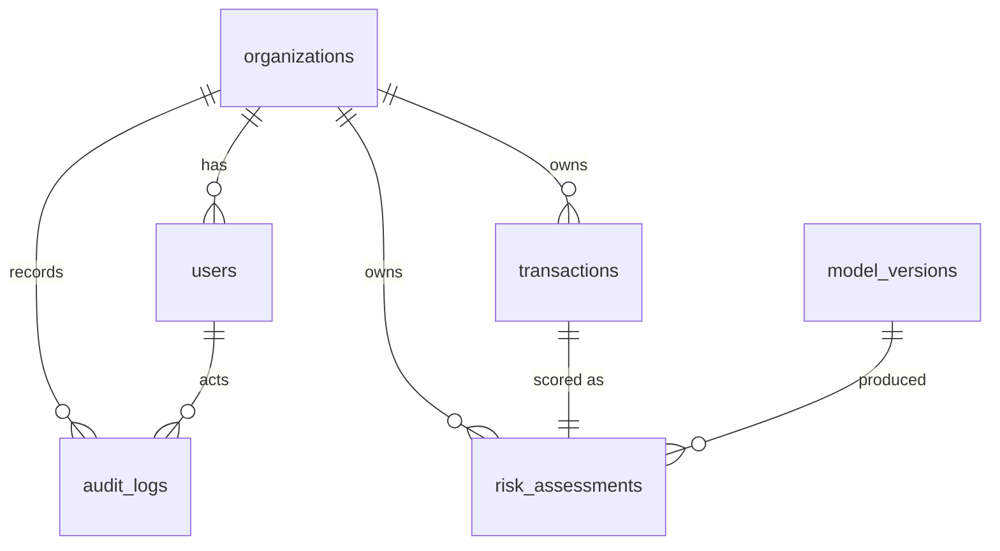

# Database design (PostgreSQL 17)

Tables are introduced by Alembic migrations when the feature that uses them ships. Migration
`0001_initial_schema` is **implemented** (CI checks `alembic check` = models and migration agree,
and upgrade/downgrade both run). Later tables are **designed** below with their DDL so the target
model can be reviewed now.

## Integrity principles

* **Every business row carries `organization_id`** and every query filters by the caller's
  organization (from the JWT, never from the request body). Isolation is tested with two tenants
  sharing customer and transaction ids.
* **Money is `NUMERIC(18,2)`**, never binary floating point. `risk_score` is a probability and is
  `DOUBLE PRECISION`.
* **All timestamps are `TIMESTAMPTZ`**, written in UTC.
* **Traceability chain:** `transactions` → `risk_assessments` (1:1, unique FK) → `model_versions`
  (FK; hash-pinned) and `policy_version` → `rule_evaluations` → `cases` → `fraud_labels`.
* **Invariants enforced in the database, not only in code:** a degraded assessment cannot be
  `allow`; `risk_score` is present iff status is `scored`; amounts are positive; `source` is one of
  `live|replay|simulated|backfill`; `audit_logs` rejects `UPDATE`/`DELETE` via trigger.
* `ON DELETE RESTRICT` everywhere: history is never cascaded away. Retention is a deliberate job
  (below), not a side effect.

## Implemented (migration 0001)



| Table | Key columns and constraints | Indexes |
|---|---|---|
| `organizations` | `id uuid PK`, `slug UNIQUE` | — |
| `users` | `organization_id FK`, `email UNIQUE`, `password_hash` (argon2id), `role CHECK IN (admin, analyst, viewer, service)`, `is_active` | `organization_id` |
| `model_versions` | `UNIQUE(name, version)`, `artifact_sha256`, `dataset_version`, `manifest JSONB`, `status CHECK IN (registered, active, retired)` | — |
| `transactions` | `UNIQUE(organization_id, external_id)` (= idempotency key), `amount NUMERIC(18,2) CHECK > 0`, `currency`, `category`, `channel`, `event_time timestamptz`, `source CHECK`, `schema_version`, `payload_sha256` | `(organization_id, customer_id, event_time)` serves the point-in-time history query; `(organization_id, event_time)` |
| `risk_assessments` | `transaction_id UNIQUE FK`, `model_version_id FK NULL`, `status`, `risk_score`, `risk_level`, `decision`, `decision_mode`, `reasons JSONB`, `policy_version`, `features JSONB` (snapshot used for the decision), `timings_ms JSONB`, `correlation_id`; checks listed above | `(organization_id, scored_at)` |
| `audit_logs` | `bigserial PK`, `organization_id`, `actor_user_id`, `action`, `resource_type`, `resource_id`, `details JSONB`, `correlation_id`; append-only trigger | `(organization_id, created_at)` |

Storing the exact feature snapshot with each decision makes every decision reproducible and is the
input for later drift monitoring and SHAP explanations.

## Designed (later phases)

```sql
-- Phase 6: rules engine. Declarative JSON conditions validated against a closed grammar
-- (field, operator from an allow-list, typed literal); never eval'd.
CREATE TABLE rule_definitions (
    id              uuid PRIMARY KEY,
    organization_id uuid NOT NULL REFERENCES organizations(id) ON DELETE RESTRICT,
    rule_key        varchar(64) NOT NULL,
    version         integer NOT NULL CHECK (version > 0),
    is_active       boolean NOT NULL DEFAULT false,
    priority        integer NOT NULL,
    action          varchar(16) NOT NULL CHECK (action IN ('flag','challenge','review','decline')),
    condition       jsonb NOT NULL,
    created_by      uuid NOT NULL REFERENCES users(id),
    created_at      timestamptz NOT NULL DEFAULT now(),
    UNIQUE (organization_id, rule_key, version)
);
CREATE UNIQUE INDEX uq_rule_active_version ON rule_definitions (organization_id, rule_key)
    WHERE is_active;                                    -- at most one active version per rule

CREATE TABLE rule_evaluations (
    id                 bigserial PRIMARY KEY,
    organization_id    uuid NOT NULL REFERENCES organizations(id),
    risk_assessment_id uuid NOT NULL REFERENCES risk_assessments(id) ON DELETE RESTRICT,
    rule_definition_id uuid NOT NULL REFERENCES rule_definitions(id) ON DELETE RESTRICT,
    matched            boolean NOT NULL,
    influenced_decision boolean NOT NULL,
    evaluated_at       timestamptz NOT NULL,
    UNIQUE (risk_assessment_id, rule_definition_id)
);

-- Phase 8: investigations
CREATE TABLE cases (
    id               uuid PRIMARY KEY,
    organization_id  uuid NOT NULL REFERENCES organizations(id),
    transaction_id   uuid NOT NULL REFERENCES transactions(id),
    severity         varchar(16) NOT NULL CHECK (severity IN ('low','medium','high','critical')),
    status           varchar(32) NOT NULL CHECK (status IN ('new','under_review','escalated',
                        'resolved_fraud','resolved_legitimate','inconclusive')),
    assigned_to      uuid REFERENCES users(id),
    opened_at        timestamptz NOT NULL DEFAULT now(),
    resolved_at      timestamptz,
    version          integer NOT NULL DEFAULT 1,     -- optimistic locking for concurrent edits
    CHECK ((status LIKE 'resolved_%' OR status = 'inconclusive') = (resolved_at IS NOT NULL))
);
CREATE INDEX ix_cases_queue ON cases (organization_id, status, severity, opened_at);

CREATE TABLE case_notes (
    id         bigserial PRIMARY KEY,
    case_id    uuid NOT NULL REFERENCES cases(id) ON DELETE RESTRICT,
    author_id  uuid NOT NULL REFERENCES users(id),
    body       text NOT NULL CHECK (length(body) BETWEEN 1 AND 10000),
    evidence   jsonb NOT NULL DEFAULT '[]',          -- references, not uploaded blobs
    created_at timestamptz NOT NULL DEFAULT now()
);

-- Labels are separate from case status so provenance and timing are explicit.
CREATE TABLE fraud_labels (
    id              bigserial PRIMARY KEY,
    organization_id uuid NOT NULL REFERENCES organizations(id),
    transaction_id  uuid NOT NULL REFERENCES transactions(id),
    label           smallint NOT NULL CHECK (label IN (0, 1)),
    source          varchar(32) NOT NULL CHECK (source IN ('analyst_review','chargeback',
                        'customer_report','dataset')),
    confidence      varchar(16) NOT NULL CHECK (confidence IN ('confirmed','probable')),
    case_id         uuid REFERENCES cases(id),
    labeled_by      uuid REFERENCES users(id),
    labeled_at      timestamptz NOT NULL,
    superseded_by   bigint REFERENCES fraud_labels(id)
);
CREATE INDEX ix_labels_txn ON fraud_labels (organization_id, transaction_id, labeled_at);

-- Phase 9: MLOps lineage and monitoring
CREATE TABLE dataset_versions (
    id            varchar(64) PRIMARY KEY,           -- e.g. ef8be78c6f87
    domain        varchar(64) NOT NULL,
    manifest      jsonb NOT NULL,
    created_at    timestamptz NOT NULL DEFAULT now()
);
CREATE TABLE training_runs (
    id                uuid PRIMARY KEY,
    dataset_version   varchar(64) NOT NULL REFERENCES dataset_versions(id),
    model_version_id  uuid REFERENCES model_versions(id),
    mlflow_run_id     varchar(64),
    config            jsonb NOT NULL,
    metrics           jsonb NOT NULL,
    git_commit        varchar(40),
    started_at        timestamptz NOT NULL,
    finished_at       timestamptz
);
CREATE TABLE monitoring_metrics (
    id               bigserial PRIMARY KEY,
    organization_id  uuid REFERENCES organizations(id),
    model_version_id uuid REFERENCES model_versions(id),
    metric           varchar(64) NOT NULL,           -- e.g. score_psi, feature_psi:log_amount
    window_start     timestamptz NOT NULL,
    window_end       timestamptz NOT NULL,
    value            double precision NOT NULL,
    labeled          boolean NOT NULL,               -- ground-truth metric vs. unlabeled signal
    UNIQUE (organization_id, model_version_id, metric, window_start)
);
```

## Retention (designed)

Configurable per organization: `transactions`/`risk_assessments` features snapshot nulled after N
days, rows deleted after M days by a scheduled job that writes an audit record per batch;
`audit_logs` retained longest; labels retained as long as models trained on them are in use.
At larger volumes `transactions` and `risk_assessments` would be range-partitioned by month on
`event_time`/`scored_at` so retention becomes partition drops.
