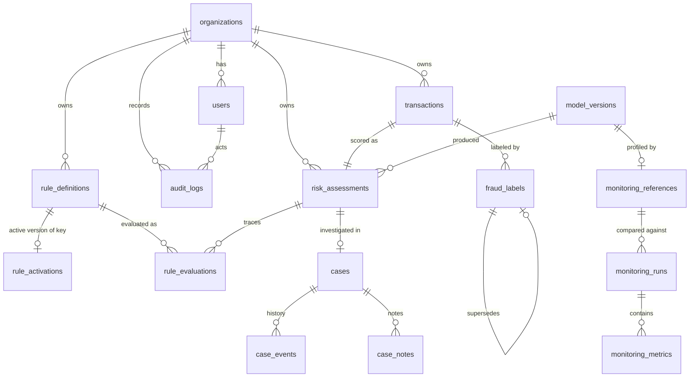

# Database design (PostgreSQL 17)

Tables are introduced by Alembic migrations when the feature that uses them ships. Migrations
`0001_initial_schema`, `0002_model_registry_policy`, `0003_rules_engine` and `0004_cases_and_labels` are **implemented** (CI checks `alembic check` = models and migration agree,
and upgrade/downgrade both run). Later tables are **designed** below with their DDL so the target
model can be reviewed now.

## Integrity principles

* **Every business row carries `organization_id`** and every query filters by the caller's
  organization (from the JWT, never from the request body). Isolation is tested with two tenants
  sharing customer and transaction ids.
* **Money is `NUMERIC(18,2)`**, never binary floating point. `risk_score` is a probability and is
  `DOUBLE PRECISION`.
* **All timestamps are `TIMESTAMPTZ`**, written in UTC.
* **Traceability chain:** `transactions` → `risk_assessments` (1:1, unique FK) → `model_versions`
  (FK; hash-pinned) and `policy_version` / `policy_decision` → `rule_evaluations` (exact rule
  versions) → `cases` → `fraud_labels`.
* **Invariants enforced in the database, not only in code:** a degraded assessment cannot be
  `allow`; `risk_score` is present iff status is `scored`; amounts are positive; `source` is one of
  `live|replay|simulated|backfill`; `audit_logs`, `rule_definitions` and `rule_evaluations` reject
  `UPDATE`/`DELETE` via trigger; a final decision is never less strict than the policy decision.
* `ON DELETE RESTRICT` everywhere: history is never cascaded away. Retention is a deliberate job
  (below), not a side effect.

## Implemented (migrations 0001–0005)



| Table | Key columns and constraints | Indexes |
|---|---|---|
| `organizations` | `id uuid PK`, `slug UNIQUE` | — |
| `users` | `organization_id FK`, `email UNIQUE`, `password_hash` (argon2id), `role CHECK IN (admin, analyst, viewer, service)`, `is_active` | `organization_id` |
| `model_versions` | `UNIQUE(name, version)`, `artifact_sha256`, `dataset_version`, `manifest JSONB`, `status CHECK IN (registered, active, retired)`; migration `0002`: `bound_policy JSONB` (version, mode, thresholds of the bound policy) and `last_activated_at` | — |
| `transactions` | `UNIQUE(organization_id, external_id)` (= idempotency key), `amount NUMERIC(18,2) CHECK > 0`, `currency`, `category`, `channel`, `event_time timestamptz`, `source CHECK`, `schema_version`, `payload_sha256` | `(organization_id, customer_id, event_time)` serves the point-in-time history query; `(organization_id, event_time)` |
| `risk_assessments` | `transaction_id UNIQUE FK`, `model_version_id FK NULL`, `status`, `risk_score`, `risk_level`, `decision`, `decision_mode`, `reasons JSONB`, `policy_version`, `features JSONB` (snapshot used for the decision), `timings_ms JSONB`, `correlation_id`; checks listed above | `(organization_id, scored_at)` |
| `risk_assessments` (migration `0003`) | `policy_decision` (decision of the model-bound policy alone; backfilled = `decision` for older rows), `rules_status CHECK IN (none, evaluated, error)` default `none`. Checks: `array_position(order, decision) >= array_position(order, policy_decision)` (rules never relax), `rules_status <> 'none' OR decision = policy_decision`, `rules_status <> 'error' OR decision IN (review, decline)` | — |
| `rule_definitions` (0003) | one immutable version per row: `UNIQUE(organization_id, rule_key, version)`, `version > 0`, `priority 0..1000`, `action CHECK IN (flag, challenge, review, decline)`, `condition JSONB` (validated grammar), `condition_sha256`, `created_by FK users`; `UNIQUE(id, organization_id, rule_key)` as composite FK target; append-only trigger | unique indexes |
| `rule_activations` (0003) | `PK(organization_id, rule_key)` = at most one active version per key; composite FK `(rule_definition_id, organization_id, rule_key)` → `rule_definitions` (cannot point at another tenant's or key's version); `activated_by`, `activated_at`. Changed only with an audit record in the same transaction | PK |
| `rule_evaluations` (0003) | `bigserial PK`, `organization_id`, `risk_assessment_id FK`, composite FK to the exact rule version, `rule_key`, `outcome CHECK IN (matched, not_matched, unknown, error)`, `influenced_decision` (only if matched/error), `error_type`; `UNIQUE(risk_assessment_id, rule_definition_id)`; append-only trigger; written in the assessment's transaction | `rule_definition_id` |
| `cases` (0004) | `UNIQUE(organization_id, transaction_id)` (one case per transaction), `risk_assessment_id UNIQUE FK`, `severity CHECK`, `status CHECK IN (new, under_review, escalated, resolved_fraud, resolved_legitimate, inconclusive)`, `assigned_to`/`opened_by FK users`, `opened_at`, `resolved_at`, `updated_at`, `version`. Checks: closed status ⇔ `resolved_at IS NOT NULL`; `resolved_at >= opened_at`; `version > 0`. Trigger `cases_guard`: no DELETE, identity columns immutable, `version` must rise by exactly 1 per UPDATE (optimistic locking) | `ix_cases_queue (organization_id, status, severity, opened_at)`, `ix_cases_assignee (organization_id, assigned_to, status)` |
| `case_events` (0004) | append-only status/assignment history: `kind CHECK IN (created, assigned, status_changed, resolved, reopened)`, `from_value`, `to_value`, `actor_id`, `case_version`; trigger forbids UPDATE/DELETE | `(case_id, id)` |
| `case_notes` (0004) | append-only: `author_id`, `body CHECK length 1..10000`, `evidence JSONB` (references, not uploads); trigger | `(case_id, id)` |
| `fraud_labels` (0004) | `label CHECK IN (fraud, legitimate, inconclusive)`, `source CHECK IN (analyst_review, chargeback, customer_report, dataset)`, `confidence CHECK IN (confirmed, probable)`, `labeled_by` (required unless `dataset`), `case_id` (required for `analyst_review`), `labeled_at` (when known), `recorded_at` (when written), `supersedes_id FK fraud_labels`, `reason`, `provenance JSONB`. `UNIQUE(supersedes_id)` + partial unique `(organization_id, transaction_id) WHERE supersedes_id IS NULL` = one linear history per transaction; trigger forbids UPDATE/DELETE | `ix_labels_txn (organization_id, transaction_id, labeled_at)`, `ix_labels_org_labeled_at` |
| `monitoring_references` (0005) | `model_version_id FK`, `artifact_sha256`, `dataset_version`, `window_start/end` (the model's validation window), `sample_size > 0`, `profile JSONB` (aggregates only: bins, quantiles, exact CDF, missing rates, vocabulary proportions, score bins, policy decision mix), `profile_sha256`, `calc_version`; `UNIQUE(model_version_id, calc_version)`; append-only trigger (reuses `rules_append_only()`) | unique index |
| `monitoring_runs` (0005) | `scope CHECK IN (organization, global)`, `organization_id` (NULL ⇔ global), `scope_key` = org id or the nil UUID (CHECK), `model_version_id`, `reference_id`, `window_start/end`, `labels_as_of`, `maturity_days`, `status CHECK IN (ok, warn, alert, insufficient_data, failed)`, `recommendation CHECK IN (none, review, retraining_review)`, `summary JSONB`, `calc_version`, `acknowledged_by/at` (both or neither), `ack_note`. **`UNIQUE(scope_key, model_version_id, window_start, window_end, calc_version)`** = idempotent reruns (upsert); trigger forbids DELETE | `(model_version_id, status, window_end)`, `(organization_id, window_end)` |
| `monitoring_metrics` (0005) | `run_id FK`, `organization_id`, `model_version_id`, `metric`, `segment`, window, `value`, `ci_low/high`, `sample_size >= 0`, `reference_size`, `labeled`, `status CHECK`, `thresholds JSONB`, `details JSONB`, `calc_version`, `computed_at`; **`UNIQUE(run_id, metric, segment)`**; trigger forbids DELETE | `(model_version_id, metric, window_end)` |
| `audit_logs` | `bigserial PK`, `organization_id`, `actor_user_id`, `action`, `resource_type`, `resource_id`, `details JSONB`, `correlation_id`; append-only trigger | `(organization_id, created_at)` |

**How rows arrive.** Scored rows come from `POST /api/v1/fraud/score` (`schema_version` = the API
request schema, e.g. `1.0`; `payload_sha256` = hash of the request). Unscored history comes from
the Phase 2 importer (`schema_version = 'canonical-1'`; `payload_sha256` = hash of the canonical
fields; `source` ∈ `backfill`, `replay`, `simulated`). Idempotency for imports compares row content,
not hashes, so rows written by earlier loaders are recognised as already present. An imported id
can never be scored later under the same id (API returns 409). Fraud labels are not stored in
`transactions`; they live in the provenance-tracked `fraud_labels` table (Phase 8), where the
dataset's `is_fraud` is recorded only as `source = 'dataset'`.

Storing the exact feature snapshot with each decision makes every decision reproducible and is the
input for drift monitoring (Phase 9) and SHAP explanations.

**Rules design notes (as built).** The Phase 1 draft put `is_active` on `rule_definitions`. The
implementation keeps versions fully immutable and moves activation into `rule_activations`, so
activating never updates a version row and the trigger can forbid all updates. Evaluations store
the exact version (`rule_definition_id`), so the decision trace survives later versions and
deactivation. Grammar, precedence and fail-safe semantics:
[rules-engine.md](rules-engine.md).

**Cases and labels design notes (as built, Phase 8).** The earlier draft is changed in four
places:
- **Supersession:** the draft's `fraud_labels.superseded_by` would have required updating the old
  label. Each correction instead points back with `supersedes_id`, so the table stays append-only.
  The two unique indexes make the history of a transaction a single chain, and concurrent
  corrections conflict instead of forking.
- **Label values:** labels are `fraud`, `legitimate` or `inconclusive` (not 0/1), and have a
  `recorded_at` separate from `labeled_at`.
- **Status history:** status and assignment history get their own append-only `case_events`
  table, in addition to `audit_logs`.
- **Assessment link:** cases reference the exact assessment.

Tenant consistency between a case or label and its transaction is enforced by the service, and
covered by tests; there are no composite foreign keys here. Semantics:
[docs/api/cases-labels-api.md](../api/cases-labels-api.md) and
[model-development-plan.md §8](../ml/model-development-plan.md).

## Designed (later phases)

```sql
-- MLOps lineage (designed; not built. Dataset and training lineage currently live in artifact
-- manifests, model_versions.manifest and MLflow.)
CREATE TABLE dataset_versions (
    id            varchar(64) PRIMARY KEY,           -- e.g. ef8be78c6f87
    domain        varchar(64) NOT NULL,
    manifest      jsonb NOT NULL,
    created_at    timestamptz NOT NULL DEFAULT now()
);
CREATE TABLE training_runs (
    id                uuid PRIMARY KEY,
    dataset_version   varchar(64) NOT NULL REFERENCES dataset_versions(id),
    model_version_id  uuid REFERENCES model_versions(id),
    mlflow_run_id     varchar(64),
    config            jsonb NOT NULL,
    metrics           jsonb NOT NULL,
    git_commit        varchar(40),
    started_at        timestamptz NOT NULL,
    finished_at       timestamptz
);
```

**Monitoring design notes (as built, Phase 9).** The earlier draft had a single
`monitoring_metrics` table keyed by organization, model, metric and window start. As built:
- **Runs:** a `monitoring_runs` row holds the window, label cutoff, status, recommendation and
  acknowledgement. Metrics belong to a run, which makes reruns idempotent at the run level.
- **Global scope:** `scope_key` lets a global (all-tenant) run take part in the unique key, since
  NULLs never collide.
- **Nullable values and intervals:** `value` is nullable because `insufficient_data` has no
  value, and metrics carry intervals, sample sizes, thresholds and the calculation version.
- **References:** profiles are stored in `monitoring_references`, append-only and tied to the
  artifact hash and dataset version.
- **Read-only to other tables:** monitoring never writes to `risk_assessments`, `cases` or
  `fraud_labels`, and never changes which model is active; tests verify this. The one registry
  write is `build-reference`, which registers an unknown candidate as `registered` (never
  active) and refuses different bytes under the same version. Promotion repoints the artifact;
  `model_versions` activation then happens at the next API start through the existing path.

## Retention (designed)

Configurable per organization: `transactions`/`risk_assessments` features snapshot nulled after N
days, rows deleted after M days by a scheduled job that writes an audit record per batch;
`audit_logs` retained longest; labels retained as long as models trained on them are in use.
At larger volumes `transactions` and `risk_assessments` would be range-partitioned by month on
`event_time`/`scored_at` so retention becomes partition drops.
