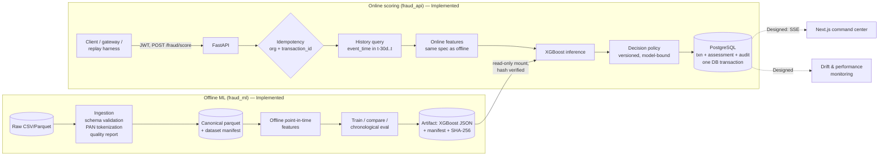

# Engineering architecture

Status legend used throughout the docs: **Implemented** (code + executed tests in this repo),
**Designed** (specified here, not built yet), **Deferred** (intentionally postponed with a reason).

## 1. Shape of the system

A **modular monolith** with two deployable processes today (scoring API, PostgreSQL) and an offline
ML package. Services are extracted only when a measured need appears (independent scaling, separate
failure domain, separate team ownership). Nothing in Phase 1 meets that bar.



## 2. Component boundaries

| Component | Responsibility | Status |
|---|---|---|
| `ml/fraud_ml/domains/card_payments.py` | Domain adapter: category vocabulary, channel derivation, assumed currency | Implemented |
| `ml/fraud_ml/data` | Raw schema (Pandera), CSV/Parquet ingestion, tokenization, dedupe, error/warning quality checks and report, dataset version ([details](../data/ingestion-and-import.md)) | Implemented (Phase 2) |
| `apps/api/fraud_api/db/importer.py` | Canonical parquet → `transactions`: tenant-scoped, source-labeled, idempotent, all-or-nothing | Implemented (Phase 2) |
| `ml/fraud_ml/features` | Feature spec + two independent implementations (vectorized offline, per-event online) | Implemented |
| `ml/fraud_ml/training`, `evaluation` | Candidate models, chronological splits, rare-event metrics, bootstrap CIs | Implemented |
| `ml/fraud_ml/models/artifact.py` | Pickle-free artifact format, hash + feature-contract verification | Implemented |
| `apps/api/fraud_api` | Auth, RBAC, scoring service, decision policy, persistence, health | Implemented |
| Rules engine | Declarative rules, versioned, audited; outcomes stored separately from ML scores | Designed (Phase 6) |
| Event ingestion + simulator | Durable queue, retries, DLQ, replay controls | Designed (Phase 5) |
| Case management | Cases, notes, dispositions, label provenance | Designed (Phase 8) |
| Web command center | Next.js dashboard over real APIs | Designed (Phase 7) |
| MLflow, drift monitoring, Prometheus/Grafana | Experiment tracking, model registry UI, operational metrics | Designed (Phase 9) |

## 3. Model inference pathway (implemented)

```mermaid
sequenceDiagram
    participant C as Client
    participant A as API (fraud_api)
    participant DB as PostgreSQL
    participant M as Model (in-process)
    C->>A: POST /api/v1/fraud/score (Bearer JWT, X-Request-ID)
    A->>A: verify JWT (HS256 pinned, iss/aud/exp), role ∈ {service, admin}
    A->>A: validate schema (422 on tz-naive time, unknown category, >2dp amount, extra fields)
    A->>DB: lookup (org, transaction_id)
    alt already scored, same payload hash
        DB-->>A: stored assessment
        A-->>C: 200 original response (idempotent_replay=true)
    else same id, different payload
        A-->>C: 409 idempotency_conflict
    end
    A->>DB: SELECT history WHERE org, customer, t-30d <= event_time < t (bounded, never truncated)
    A->>A: compute features (spec card-v1)
    A->>M: predict_proba(1×34)
    A->>A: policy.decide(score) → risk level + sandbox decision + reasons
    A->>DB: INSERT transaction, risk_assessment, audit_log (single commit; unique index resolves races)
    A-->>C: 200 decision response
```

**Failure semantics.** A failed feature computation or inference never becomes `allow`.

| Mode (`FRAUD_FAILURE_MODE`) | Behaviour | Trade-off |
|---|---|---|
| `manual_review` (default) | Persist with `status=degraded`, `risk_score=NULL`, `decision=review` | Fraud is not waved through, but every outage adds analyst queue load |
| `reject` | HTTP 503 + `Retry-After`; nothing persisted | Caller owns the fallback; risks fail-open if the caller allows on error |
| *fail-open (allow)* | **Not offered** | Lowest friction, highest fraud exposure during outages |

Database failures are not "degraded scores": nothing can be persisted, so the request fails with
5xx and the client retries with the same `transaction_id` (idempotent). The DB also enforces
`status='scored' OR decision<>'allow'` with a check constraint.

## 4. Streaming design (Phase 5 — designed, not built)

The required stages are ingestion → validation → features → inference → policy → persistence →
dashboard update. Phase 1 executes all of them synchronously inside one request, which is the
correctness baseline the streaming path must reproduce.

**Broker choice: Redis Streams first, Kafka only if justified.**

| Criterion | Redis Streams | Kafka |
|---|---|---|
| Throughput needed (replay demo: 10²–10³ ev/s) | Ample | Ample |
| Delivery | At-least-once via consumer groups + `XACK`, `XPENDING`/`XAUTOCLAIM` for retries | At-least-once (exactly-once only inside Kafka transactions) |
| Ordering | Per stream; partition by `customer_id` hash into N streams | Per partition |
| Ops footprint locally | One container, also usable for cache/rate limiting | Broker + KRaft controller, heavier |
| Retention/replay | Bounded by memory (`MAXLEN`) | Long, disk-based — better for true event sourcing |

Kafka becomes justified if we need multi-day durable replay, multiple independent consumer
applications, or sustained throughput beyond a single Redis node.

**Delivery semantics (honest statement):** the pipeline will be *at-least-once delivery with
idempotent effects*. Duplicate deliveries are absorbed by the `(organization_id, external_id)`
unique constraint and payload hash, which Phase 1 already implements and tests (including
concurrent duplicates). This is **not** exactly-once processing and will not be described as such.

```mermaid
flowchart LR
    SIM[Replay simulator<br/>rate, speed, pause, seed] -->|XADD events:{shard}| RS[(Redis Streams<br/>sharded by customer)]
    RS --> W[Scoring workers<br/>consumer group]
    W -->|same service code as API| DB[(PostgreSQL)]
    W -->|after N failed attempts| DLQ[(Dead-letter stream)]
    DB --> SSE[SSE /api/v1/events/stream]
    W -. lag, pending, latency .-> PROM[Prometheus]
```

Ordering assumption: features for event *t* use history with `event_time < t` that **has already
been persisted**. Sharding by customer keeps one customer's events on one consumer in order; late
or out-of-order arrivals will see less history than the offline computation did. That skew will be
measured (Phase 5 parity test) rather than assumed away.

## 5. Persistence

PostgreSQL is the system of record (see [database-design.md](database-design.md)). Redis is
**not** used in Phase 1: idempotency lives in the database so it survives restarts and cannot
disagree with the stored decision. Redis enters with the streaming layer (and possibly a feature
cache, if measured history-query latency requires it — at present the history query is part of a
3.3 ms p50 server-side path).

Historical events enter PostgreSQL through the batch importer (`fraud_api.cli
import-transactions`): one transaction per import, `COPY` into a staging table, content-based
idempotency and conflict detection, and a per-tenant advisory lock. Imported rows are unscored
history (`source` = `backfill`/`replay`/`simulated`) that the online features read; they are never
labeled as live traffic.

## 6. Frontend integration (Phase 7 — designed)

Next.js + TanStack Query against the versioned REST API; live updates over SSE (one-way
server→client fits a monitoring feed better than WebSockets and passes through proxies easily).
Every chart reads an analytics endpoint backed by SQL over stored assessments — no client-side
constants. Traffic is labeled by `source` (`live`/`replay`/`simulated`/`backfill`) and the UI must
show that label.

## 7. Operational monitoring strategy

| Signal | Where | Status |
|---|---|---|
| Structured JSON request logs with correlation ID, latency, status; secret/identifier redaction | API | Implemented |
| Per-assessment timings (`features`, `inference`, `total`) stored with each decision | DB | Implemented |
| `/health/live`, `/health/ready` (DB + model + policy) | API | Implemented |
| Prometheus metrics: RPS, latency histograms (p50/p95/p99), error rate, queue depth, consumer lag | API, workers | Designed (Phase 9) |
| Prediction drift (score PSI vs. validation), feature drift (PSI/KS per feature), alert rate | Batch job over `risk_assessments` | Designed (Phase 9) |
| Label-matured precision/recall, kept separate from unlabeled drift signals | Batch job over labels | Designed (Phase 8/9) |

Latency targets are engineering objectives, not guarantees: **p95 ≤ 50 ms server-side** for a
single score at the documented hardware. The current measurement is in the README and
`ml/reports/replay_*.json`.
