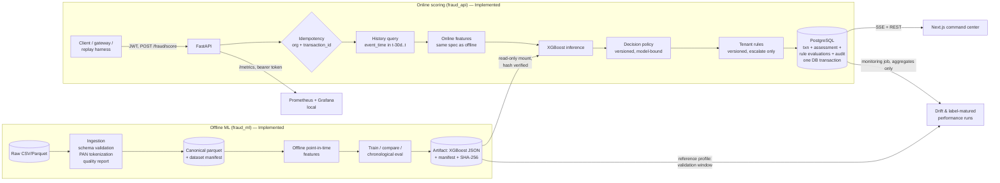
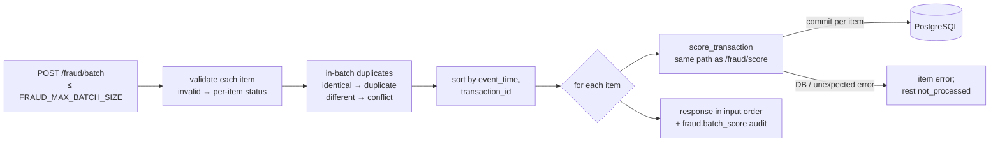

# Engineering architecture

Status legend used throughout the docs: **Implemented** (code + executed tests in this repo),
**Designed** (specified here, not built yet), **Deferred** (intentionally postponed with a reason).

## 1. Shape of the system

A **modular monolith** with two deployable processes today (scoring API, PostgreSQL) and an offline
ML package. Services are extracted only when a measured need appears (independent scaling, separate
failure domain, separate team ownership). Nothing in Phase 1 meets that bar.



## 2. Component boundaries

| Component | Responsibility | Status |
|---|---|---|
| `ml/fraud_ml/domains/card_payments.py` | Domain adapter: category vocabulary, channel derivation, assumed currency | Implemented |
| `ml/fraud_ml/data` | Raw schema (Pandera), CSV/Parquet ingestion, tokenization, dedupe, error/warning quality checks and report, dataset version ([details](../data/ingestion-and-import.md)) | Implemented (Phase 2) |
| `apps/api/fraud_api/db/importer.py` | Canonical parquet → `transactions`: tenant-scoped, source-labeled, idempotent, all-or-nothing | Implemented (Phase 2) |
| `ml/fraud_ml/features` | Feature spec + two independent implementations (vectorized offline, per-event online) | Implemented |
| `ml/fraud_ml/training`, `evaluation` | Candidate models, chronological splits, rare-event metrics, bootstrap CIs | Implemented |
| `ml/fraud_ml/models/artifact.py` | Pickle-free artifact format, hash + feature-contract verification | Implemented |
| `apps/api/fraud_api` | Auth, RBAC, scoring service, decision policy, persistence, health | Implemented |
| `apps/api/fraud_api/scoring/batch.py` | `POST /fraud/batch`: per-item validation, in-batch de-duplication, `(event_time, transaction_id)` ordering, per-item transactions through the single-event service ([API](../api/scoring-api.md)) | Implemented (Phase 4) |
| `apps/api/fraud_api/registry` | Model registry: activation at startup, `register-model` for candidates, read-only metadata endpoints | Implemented (Phase 4) |
| `apps/api/fraud_api/rules` | Tenant rules: closed JSON grammar (no eval), immutable versions, atomic audited activation, escalate-only precedence, fail-safe errors, per-assessment trace ([rules engine](rules-engine.md)) | Implemented (Phase 6) |
| `apps/api/fraud_api/insights/analytics.py` | Bounded-window aggregates: volume, decision/risk mix, alert and escalation rates, rule hits, latency ([definitions](rules-engine.md#analytics-definitions)) | Implemented (Phase 6) |
| `apps/api/fraud_api/stream` | Redis Streams ingest, sharded workers, retries/DLQ, replay simulator, SSE feed ([streaming](streaming.md)) | Implemented (Phase 5) |
| `apps/api/fraud_api/cases`, `labels` | Investigation cases (status machine, assignment, optimistic locking, append-only notes and history) and provenance-tracked, append-only fraud labels with supersession; label-matured performance kept apart from unlabeled signals ([API](../api/cases-labels-api.md), [labels](../ml/model-development-plan.md)) | Implemented (Phase 8) |
| `apps/web` | Next.js command center over real APIs: transactions with decision and rule trace, analytics, rules, authenticated live feed ([command center](command-center.md)) | Implemented (Phase 7) |
| `apps/api/fraud_api/observability` | Prometheus metrics with bounded labels (route templates, closed value sets), token-protected `/metrics`, scrape-time stream gauges, worker metrics on loopback ([operations](../operations/monitoring.md)) | Implemented (Phase 9) |
| `apps/api/fraud_api/monitoring` | Reference profiles from each model's validation window, drift (PSI/KS, bootstrap and Wilson intervals), label-matured performance, idempotent persisted runs, promotion gates, audited `promote`/`rollback` CLI ([model monitoring](../ml/monitoring.md)) | Implemented (Phase 9) |
| `infrastructure/monitoring` | Local Prometheus config, 8 alert rules, provisioned Grafana dashboard (Compose profile `monitoring`) | Implemented (Phase 9); no Alertmanager, no managed service |
| `scripts/load_test.py` | Concurrent load test (burst/steady) for single, batch, ingest + workers and SSE, with database effect checks ([load testing](../operations/load-testing.md)) | Implemented (Phase 9) |
| MLflow | Experiment tracking with a guard against transaction data (Phase 3) | Implemented; no hosted MLflow server |

## 3. Model inference pathway (implemented)

```mermaid
sequenceDiagram
    participant C as Client
    participant A as API (fraud_api)
    participant DB as PostgreSQL
    participant M as Model (in-process)
    C->>A: POST /api/v1/fraud/score (Bearer JWT, X-Request-ID)
    A->>A: verify JWT (HS256 pinned, iss/aud/exp), role ∈ {service, admin}
    A->>A: validate schema (422 on tz-naive time, unknown category, >2dp amount, extra fields)
    A->>DB: lookup (org, transaction_id)
    alt already scored, same payload hash
        DB-->>A: stored assessment
        A-->>C: 200 original response (idempotent_replay=true)
    else same id, different payload
        A-->>C: 409 idempotency_conflict
    end
    A->>DB: SELECT history WHERE org, customer, t-30d <= event_time < t (bounded, never truncated)
    A->>A: compute features (spec card-v1)
    A->>M: predict_proba(1×34)
    A->>A: policy.decide(score) → risk level + policy decision + reasons
    A->>DB: SELECT active rule versions (org)
    A->>A: evaluate rules → final decision (never less strict than policy), trace
    A->>DB: INSERT transaction, risk_assessment, rule_evaluations, audit_log (single commit; unique index resolves races)
    A-->>C: 200 decision response
```

**Failure semantics.** A failed feature computation or inference never becomes `allow`.

| Mode (`FRAUD_FAILURE_MODE`) | Behaviour | Trade-off |
|---|---|---|
| `manual_review` (default) | Persist with `status=degraded`, `risk_score=NULL`, `decision=review` | Fraud is not waved through, but every outage adds analyst queue load |
| `reject` | HTTP 503 + `Retry-After`; nothing persisted | Caller owns the fallback; risks fail-open if the caller allows on error |
| *fail-open (allow)* | **Not offered** | Lowest friction, highest fraud exposure during outages |

Database failures are not "degraded scores": nothing can be persisted, so the request fails with
5xx and the client retries with the same `transaction_id` (idempotent). The DB also enforces
`status='scored' OR decision<>'allow'` with a check constraint.

**Rules (Phase 6).** After the policy, the tenant's active rule versions are evaluated in the same
transaction. Rules can only escalate (`allow < challenge < review < decline`; `flag` records a
hit only), so `decision` is never less strict than `policy_decision`. A rule evaluation error
escalates to at least the policy's `on_scoring_failure` and is recorded (`rules_status=error`).
The stored `risk_score` and `policy_decision` are never changed by rules. Check constraints
enforce these invariants in the database too. Details: [rules-engine.md](rules-engine.md).

### Batch pathway (Phase 4)



Ordering makes a customer's earlier batch events part of the history of their later events.
Per-item commits keep the single-request semantics: idempotent retries, unique-index race
resolution and one audit record per item. Measured on 20,000 real events: identical features,
scores and decisions to sequential requests, at ≈ 1.5× the throughput (212.6 vs 137.5 events/s,
single client). Full contract: [docs/api/scoring-api.md](../api/scoring-api.md).

### Model registry

`model_versions` holds every hash-verified version. Startup activation sets the loaded version to
`active`, records its bound policy, and demotes any other active version of the same name.
`fraud_api.cli register-model` records a candidate as `registered` with its policy. Promotion
remains the gated `promote-model` step: changing `ml/artifacts/current` and the policy file,
then restarting, is what activates a new version. The metadata endpoints only read.

## 4. Event streaming (Phase 5 — implemented)

Full behaviour, limits and commands: [streaming.md](streaming.md).

* **Broker:** Redis Streams (7.4, AOF `everysec`), chosen over Kafka. Throughput needs are modest,
  it is a single local container, and consumer groups with `XACK`/`XAUTOCLAIM` give at-least-once
  delivery. Kafka would be justified by multi-day durable replay, many independent consumer
  applications or throughput beyond one Redis node.
* **Path:** `POST /api/v1/events` (validate, label, tenant from token, customer-hash shard, atomic
  enqueue, backpressure) → one leased worker per shard → `score_transaction` (unchanged single
  path) → after commit: feed publish + `XACK` + `XDEL` in one `MULTI` → SSE
  `GET /api/v1/stream/assessments` (tenant-scoped, `Last-Event-ID` resume, retention `reset`).
* **Semantics:** at-least-once delivery with idempotent database effects (not exactly-once).
  Per-customer order is the ingest order. Late events are scored with the history stored so far
  and flagged; events beyond the late tolerance are dead-lettered. Transient failures get
  bounded retries with backoff, and poison or exhausted messages go to a replayable dead-letter
  stream. Failures never produce an assessment, so never `allow`.
* **Replay simulator** (`fraud_api.stream.simulator`): deterministic event order (replay from
  parquet or seeded synthetic data), rate and event-time speed control, pause/resume, and
  `source=replay` / `source=simulated` labels.

## 5. Persistence

PostgreSQL is the system of record (see [database-design.md](database-design.md)). Redis is
**not** used in Phase 1: idempotency lives in the database so it survives restarts and cannot
disagree with the stored decision. Redis enters with the streaming layer (and possibly a feature
cache, if measured history-query latency requires it — at present the history query is part of a
3.3 ms p50 server-side path).

Historical events enter PostgreSQL through the batch importer (`fraud_api.cli
import-transactions`): one transaction per import, `COPY` into a staging table, content-based
idempotency and conflict detection, and a per-tenant advisory lock. Imported rows are unscored
history (`source` = `backfill`/`replay`/`simulated`) that the online features read; they are never
labeled as live traffic.

Rule definitions and evaluations (Phase 6, migration `0003`) are append-only (trigger). The
active version per rule key lives in `rule_activations`, changed only together with its audit
record.

## 6. Frontend integration (Phase 7 — implemented)

Next.js 15 (App Router, client components, no extra UI libraries) against the versioned REST
API through a same-origin proxy (`next.config.ts` rewrites), so the bearer token never leaves the
origin and the API needs no CORS. Live updates use SSE read with `fetch` + `ReadableStream`,
because EventSource cannot send `Authorization`. Every chart reads an analytics endpoint backed by
SQL over stored rows, with no client-side constants, and source labels are shown everywhere.
Details, the feed client's reconnect semantics and the verification record:
[command-center.md](command-center.md).

## 7. Operational monitoring strategy

| Signal | Where | Status |
|---|---|---|
| Structured JSON request logs with correlation ID, latency, status; secret/identifier redaction | API | Implemented |
| Per-assessment timings (`features`, `inference`, `total`) stored with each decision | DB | Implemented |
| `/health/live`, `/health/ready` (DB + model + policy) | API | Implemented |
| Prometheus metrics: request rate, latency histograms, 5xx, scoring stage time, decisions, degraded scores, batch/ingest/worker outcomes, stream backlog/pending/lag/DLQ, SSE connections, DB/Redis errors | API (`/metrics`), workers (`--metrics-port`) | Implemented (Phase 9) |
| Alert rules and dashboard | Local Prometheus + Grafana | Implemented (Phase 9); alerts are not routed anywhere (no Alertmanager) |
| Prediction drift (score PSI/KS vs. the model's validation window), feature drift (PSI/KS, missing and unseen categories), decision mix and alert rate, by source and tenant | `fraud_api.monitoring.cli run` over stored feature snapshots in `risk_assessments` | Implemented (Phase 9); scheduling is a loop or cron, no hosted scheduler |
| Label-matured precision/recall/FPR, kept separate from unlabeled signals | `GET /fraud/insights/performance` (Phase 8) and persisted per monitoring run (Phase 9) | Implemented |
| Promotion gates (integrity, policy binding, feature contract, reproducibility, parity, samples, drift, performance, unresolved monitoring alerts) | `fraud_api.monitoring.cli gates/promote/rollback` | Implemented (Phase 9) |

Latency targets are engineering objectives, not guarantees: **p95 ≤ 50 ms server-side** for a
single score at the documented hardware. Sequential latency is in the README and
`ml/reports/replay_*.json`; concurrent load results (synthetic data, one laptop) are in
[load-testing.md](../operations/load-testing.md).
