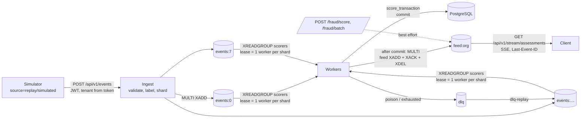

# Event streaming (Phase 5)

Redis Streams ingestion → sharded consumer-group workers → the **existing** scoring service
(`score_transaction`, unchanged: features, inference, policy, persistence, audit) → per-tenant
assessment feed → authenticated Server-Sent Events.



## Running it locally

```bash
docker compose up -d --wait postgres redis       # Redis 7.4 on 127.0.0.1:6380 (password in .env)
make migrate
make api                                         # needs FRAUD_REDIS_URL in .env
make stream-init                                 # create consumer groups (idempotent)
make worker WORKER=w0 SHARDS=0-3                 # one process per shard range
make worker WORKER=w1 SHARDS=4-7
FRAUD_SIM_PASSWORD=... make simulate EMAIL=svc@demo.example.com LIMIT=2000   # source=replay
make stream-status                               # backlog, pending, leases, dead letters
uv run python -m fraud_api.stream.cli dlq-list
uv run python -m fraud_api.stream.cli dlq-replay --ids <dlq-id> [--allow-late]
curl -N -H "Authorization: Bearer $TOKEN" http://127.0.0.1:8000/api/v1/stream/assessments
```

Without `FRAUD_REDIS_URL` the API behaves exactly as in Phase 4, and the streaming endpoints
return `503 stream_unavailable`.

## Ingest: `POST /api/v1/events` (service, admin)

* Body `{"items": [ScoreRequest, …]}`, 1 to `FRAUD_MAX_BATCH_SIZE` (500) items; more → 413.
* Each item is validated on its own; invalid items come back as `invalid` with locations only
  (no values) and are not queued.
* **Tenant identity** comes from the token; a body field naming an organization is rejected
  (unknown fields are forbidden).
* **Labels:** the item's `source` (`live` | `replay` | `simulated`) is carried through to the stored
  transaction. The envelope adds `ingested_at` and the correlation ID.
* **Sharding:** `sha256(organization_id:customer_id) mod FRAUD_STREAM_SHARDS` (default 8).
* **Atomic enqueue:** all valid items of a request go in one `MULTI`; either all are queued or
  none are.
* **Backpressure:** if any target shard holds ≥ `FRAUD_STREAM_MAX_BACKLOG` (100,000)
  unprocessed messages → `503 ingest_backpressure` with `Retry-After: 5`; nothing is queued.
* Response `202` with per-item `queued` / `invalid`, `shard`, `message_id`. **202 means queued,
  not scored.** Redis runs with AOF `appendfsync everysec`, so a Redis crash can lose up to about
  1 s of acknowledged ingests.

## Ordering

* **Within a customer:** all of a customer's events go to one shard, and exactly one worker
  consumes a shard at a time (lease: `SET NX PX`, renewed while working, re-checked before every
  message). The shard is processed strictly in stream order: pending (claimed) messages first,
  then new ones. A message being retried blocks the rest of its shard. Result: a customer's events
  are scored **in ingest order**.
* **Across customers:** no ordering guarantee (different shards, different workers).
* **Late or out-of-order events:** "late" means the customer already has a stored event with a
  later `event_time`.
  * Within `FRAUD_STREAM_LATE_TOLERANCE_SECONDS` (default 7 days): the event is scored with the
    point-in-time history stored so far (only events strictly before it) and flagged
    `late_arrival: true` on the feed. Assessments already made for later events are **not**
    re-scored, so they did not see the late event. This is the main way streaming can differ from
    an offline recomputation.
  * Beyond the tolerance: dead-lettered as `late_beyond_tolerance`, never silently scored.
    `dlq-replay --allow-late` scores it deliberately after review.
* Synchronous `/fraud/score` and `/fraud/batch` keep their own semantics; the stream does not
  serialize against them.

## Delivery and acknowledgement

**At-least-once delivery with idempotent database effects. Not exactly-once.**

1. The worker reads a message with `XREADGROUP` (consumer group `scorers`).
2. `score_transaction` commits the transaction, assessment and audit record in one database
   transaction. It is idempotent on `(organization, transaction_id)`.
3. **Only after that commit**, one Redis `MULTI` publishes the feed entry, `XACK`s, `XDEL`s the
   message and clears its attempt counter.

A crash between steps 2 and 3 leaves the message pending. When a worker next acquires the shard
(lease expiry; default 15 s, `--lease-ms`), it `XAUTOCLAIM`s the shard's pending messages and
reprocesses them. The rerun is an idempotent replay (same assessment, no duplicate rows) and is
published to the feed again. The feed is therefore also at-least-once, and clients
de-duplicate by `assessment_id`.

## Retries and dead letters

| Condition | Handling | DLQ `reason` |
|---|---|---|
| Envelope unparseable | DLQ immediately | `malformed_message` |
| Payload fails `ScoreRequest` | DLQ immediately (detail lists field/type, never values) | `invalid_payload` |
| Older than the late tolerance | DLQ immediately | `late_beyond_tolerance` |
| Same id, different payload / imported history | DLQ immediately (permanent) | `idempotency_conflict`, `transaction_exists_unscored` |
| Database error, Redis error, `scoring_unavailable` (reject mode), unexpected exception | Retry with exponential backoff (0.2 s × 2ⁿ, max 5 s) | after `max_attempts` (5): `retries_exhausted` (detail = error **type** only) |
| Attempt counter already at the limit (e.g. the message crashes every worker) | DLQ before another attempt | `attempts_exhausted` |

* The attempt counter lives in Redis (`{prefix}:attempts:{shard}`), so it survives worker
  crashes.
* A dead letter records the reason, a fixed explanation, the source shard and message ID, the
  organization, `transaction_id`, attempts, time and worker, plus the **original envelope** so it
  can be replayed. The DLQ is an internal operations stream: it is not exposed through the API
  and is protected by the Redis password.
* `dlq-replay` re-enqueues the envelope on its customer's shard (marked `dlq_replay_of`,
  optionally `allow_late`) and removes the DLQ entry in one `MULTI`.
* **A failure never becomes `allow`:** failed messages create no assessment at all. With the
  model unavailable in `manual_review` mode, scoring succeeds as `degraded` / `review`, exactly
  as in the API.

## Assessment feed and SSE: `GET /api/v1/stream/assessments`

* Roles: admin, analyst, viewer, service. **Tenant-scoped:** the feed key is derived from the
  token's organization.
* Published after commit by workers (`path: "stream"`, with `ingested_at` and `late_arrival`),
  and best effort by `/fraud/score` (`"api"`) and `/fraud/batch` (`"batch"`). If Redis is down,
  the synchronous request still succeeds and the feed misses that entry.
* **Fields (allowlist):** `assessment_id`, `transaction_id`, `status`, `risk_score`,
  `risk_level`, `decision`, `policy_decision` (Phase 6), `decision_mode`, `model_version`, `policy_version`, `source`,
  `scored_at`, `event_time`, `path`, `ingested_at`, `late_arrival`, `idempotent_replay`. Amount,
  customer, merchant, region and features are never included.
* **Headers:** `Cache-Control: no-cache, no-transform` and `X-Accel-Buffering: no`. `no-transform`
  (added in Phase 7) stops proxies such as the Next.js server from gzip-buffering the stream.
  Uvicorn's graceful shutdown waits for open SSE connections; set `--timeout-graceful-shutdown`
  in deployments. Browser client semantics: [command-center.md](command-center.md).
* **Cursor:** the Redis stream ID, sent as the SSE `id:`. Reconnect with `Last-Event-ID` (browsers
  do this automatically) or `?cursor=`; delivery resumes strictly after it. Use `?cursor=0-0` for
  everything retained. Without a cursor, the client gets only new events.
* **Retention:** about `FRAUD_FEED_MAX_LEN` (100,000) entries per tenant. If the cursor may be
  older than retained history, the server sends `event: reset`
  (`{"reason": "cursor_expired", "oldest_available": …}`) before continuing, and the client
  should re-sync from `GET /api/v1/fraud/assessments`. The check is conservative: it can
  over-report, never miss.
* Heartbeat comments every 15 s. Connections close after `limit` events, `idle_timeout`
  seconds, or 30 minutes (`FRAUD_SSE_MAX_CONNECTION_SECONDS`). Reconnecting re-checks the token.
  Browsers' `EventSource` cannot send an `Authorization` header, so a browser client needs a
  fetch-based SSE reader (or a future cookie session).

## Operations

* `make stream-status` / `GET /api/v1/stream/status` (admin) report per-shard `backlog` (queued
  + in flight; processed messages are deleted), `pending` (delivered, not acknowledged), the
  lease owner and TTL, and the dead-letter count.
* Workers log `stream_worker_stats` (scored, degraded, replayed, retried, dead_lettered,
  late_arrival) periodically.
* Stop workers with SIGTERM/SIGINT: the current message finishes and leases are released.

## Measured on real data (2026-10-26/27)

Setup: Apple M4 Pro (14 cores), macOS 26.6.1, Python 3.12.13, PostgreSQL 17.6 and Redis 7.4.2
in Docker on the same host. API: 1 uvicorn worker. **4 stream worker processes**, each owning 2
of 8 shards. A throwaway database had two organizations with the same 30-day imported history.
The first 20,000 held-out test-window events (from 2020-06-21 12:14 UTC) were replayed by the
simulator (`source=replay`, chunks of 500, no rate cap; `sequence_sha256 780e6015…`, identical
across runs).

| Run | Result |
|---|---|
| Ingest | 20,000 accepted / 0 rejected in 40 requests, 0.70 s |
| Drain (bulk backlog) | peak backlog 19,895 at 1.5 s; backlog 0 at 61.2 s; **333 events/s** from first ingest to last commit, including the crash drill |
| End-to-end latency, bulk run (ingest → committed assessment) | p50 27.8 s, p95 52.8 s: queueing behind the 20,000-event burst, not processing time |
| End-to-end latency, steady state (4,000 further events paced at 200 events/s) | **p50 7.0 ms, p95 16.1 ms, p99 26.1 ms**, max 65.9 ms |
| Crash drill | worker `w1` (shards 2–3) killed with `kill -9` at 8,056 committed assessments; replacement started 4 s later, claimed the pending messages, and recorded **1 idempotent replay**, 0 duplicates |
| Errors | 0 dead letters, 0 degraded, 0 worker errors, 0 lease losses |
| Integrity | 20,000 assessments for 20,000 distinct transactions; feed: 20,000 distinct assessments (one duplicate entry from the crash replay, as at-least-once allows) |
| Parity with synchronous scoring | the same 20,000 events via `POST /fraud/batch` in the second organization: **20,000 / 20,000 identical features, scores, risk levels, decisions and reasons** |
| Synchronous comparison throughput | `/fraud/batch` × 500, one client: 186.9 events/s |

Two defects were found by these runs and fixed before the final run:
1. **Lease expiry during long runs.** Leases were renewed only between read batches, so draining
   a large backlog could outlive a 3 s lease, and other owned shards' leases lapsed. Now every
   message renews its shard (compare-and-`PEXPIRE`) and all owned leases every third of a lease
   period. Regression test: `test_lease_is_renewed_per_message_during_long_runs`.
2. **Last-bit feature differences.** 195 of 20,000 assessments differed in the 16th significant
   digit of window aggregates (max relative difference 4.3e-16; scores and decisions unaffected),
   because the history query had no `ORDER BY`. The query now orders by
   `(event_time, external_id)`, which made parity exact. This one-line change is in the shared
   scoring service.

## Limits and risks

* Not exactly-once: duplicates are absorbed by the database and must be tolerated by feed
  consumers.
* A paused (not crashed) worker whose lease expired can process a message concurrently with the
  new owner. Ownership is re-checked before each message, which narrows but does not eliminate
  this window. Effects stay idempotent, but per-customer order can be violated for those
  messages. True fencing would need the database to reject stale lease epochs.
* Head-of-line blocking: a retried message delays its whole shard (by up to about 9 s of backoff
  with the defaults).
* Changing `FRAUD_STREAM_SHARDS` while messages are queued breaks per-customer ordering: drain
  first.
* Redis durability is AOF `everysec`; there is no replication or Redis Cluster here.
* The DLQ keeps original payloads (pseudonymous customer tokens and amounts). Access is limited
  to whoever holds the Redis credentials.
